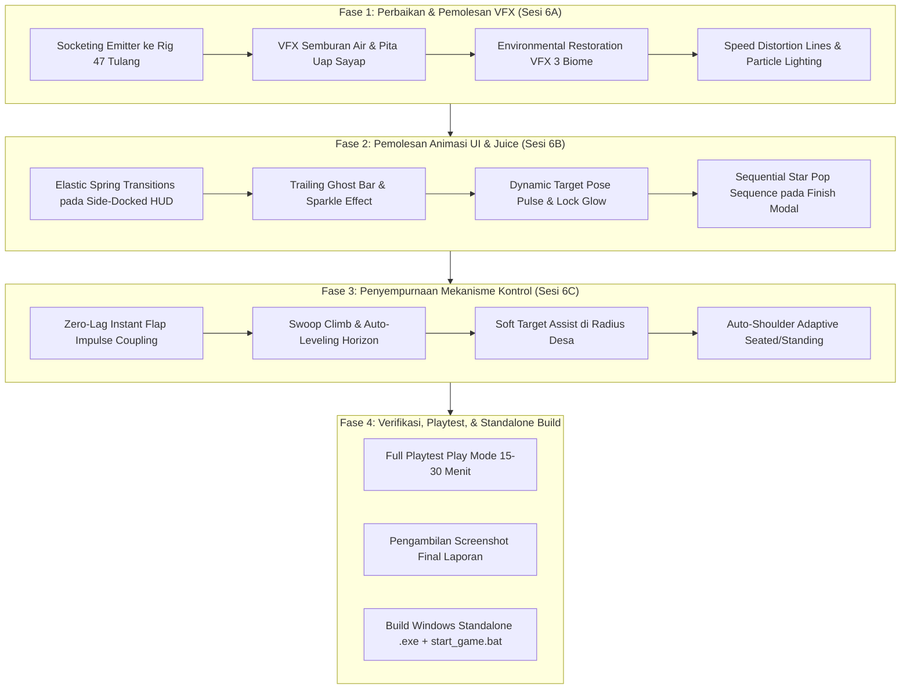

# 🚀 Planning Pasca-Animasi: Perbaikan VFX, Pemolesan Animasi UI, & Penyempurnaan Mekanisme Kontrol
## Fanamir: The Sky Guardian *(Internal Project: AR Dragon)*

> **Dokumen Master Desain & Arsitektur (Laptop A):**
> Dokumen ini merumuskan cetak biru komprehensif untuk fase pengembangan pasca integrasi animasi naga Fanamir (`DragonBodyAnimator.cs`, gait jalan darat 4 kaki, elevasi dada hover, rahang buka mulut, liukan ekor dinamis, dan anatomi sayap 12-tulang).
>
> Fokus fase ini mencakup 3 pilar penyempurnaan utama:
> 1. **Perbaikan & Pemolesan VFX (Visual Effects Polish):** Penyelarasan soket partikel ke tulang rig hidup, penguatan feedback visual aksi 3 desa, efek kecepatan tinggi (*sonic barrier & wind cone*), dan interaksi lingkungan/atmosfer URP.
> 2. **Peningkatan Animasi & "Juice" UI (UI Animation & Micro-Interactions):** Mengubah antarmuka statis menjadi responsif kinetik (transisi perkamen, denied-entry shake, trailing ghost progress bar, denyut kartu pose target, dan kembang api bintang modal selesai).
> 3. **Penyempurnaan Mekanisme Kontrol & Ergonomi Exergaming:** Sinkronisasi visual-ke-fisika tanpa lag, penanganan kelelahan pemain (*fatigue management*), penyesuaian kurva belok *banking roll*, asistensi manuver di area krisis, serta ketahanan tracking kamera.

---

## 🧭 Peta Strategis 3 Pilar Pasca-Animasi

```text
┌──────────────────────────────────────────────────────────────────────────────────────────────────┐
│                   ROADMAP PENYEMPURNAAN PASCA-ANIMASI FANAMIR                                    │
├───────────────────────────────┬──────────────────────────────────┬───────────────────────────────┤
│    PILAR 1: PERBAIKAN VFX     │     PILAR 2: ANIMASI & JUICE UI  │   PILAR 3: KONTROL & ERGONOMI │
├───────────────────────────────┼──────────────────────────────────┼───────────────────────────────┤
│ 1. Rig-Socketed Emitters      │ 1. Dynamic Spring Transitions    │ 1. Zero-Lag Visual-to-Physics │
│    • Jaw Water Breath         │    • Side-Docked Challenge HUD   │    • Instant Flap Impulse     │
│    • Wingtip Vapor Trails     │    • Narrative Parchment Unroll  │    • Seamless Dive-to-Swoop   │
│    • Chest Celestial Beacon   │ 2. Trailing Ghost Progress Bar   │ 2. Fatigue Management System  │
│ 2. Enhanced Biome Restoration │    • Dual-layer fill effect      │    • Micro-rest glide zones   │
│    • Island Dissolve Shaders  │    • Bubble splash at head       │    • Scaled exercise intensity│
│    • Smog/Steam Clearing Shock│ 3. Kinetic Feedback Widgets      │ 3. Banking & Steering Tuning  │
│ 3. Speed & Supersonic Sense   │    • Target Pose Pulse & Glow    │    • Decoupled Roll/Pitch     │
│    • Dynamic Wind Cone        │    • Momentum Bar Stress Shake   │    • Soft Target Assist in B3 │
│    • Speed Lines & Lens Radial│ 4. Celebratory Star Pop Sequence │ 4. Adaptive Seated/Standing   │
│ 4. URP Particle Light Emission│    • Elastic Punch & Chime Sync  │    • Auto-shoulder height     │
└───────────────────────────────┴──────────────────────────────────┴───────────────────────────────┘
```

---

## 🌌 PILAR 1: Perbaikan & Pemolesan Sistem VFX (Visual Effects)

### 1.1. Penyelarasan Emitter ke Tulang Rig Hidup (*Rig-Socketed Particle Systems*)
Sebelumnya, sistem VFX Effekseer dan partikel Unity diletakkan pada posisi statis atau offset kasar root `/Dragon_Player`. Pasca integrasi rig 47 tulang, emitter wajib diikat (*parented*) ke transformasi tulang spesifik agar efek visual terpancar secara anatomis:

| Aset Partikel (`.efkefc` / URP) | Tulang Jangkar (*Socket Bone*) | Offset Relatif Tulang | Deskripsi & Perilaku Visual |
| :--- | :--- | :--- | :--- |
| **`VFX_Pyrewood_WaterBreath`** | `Bone_Jaw` & `Head` | `(0, -0.05, 0.45)` | Semburan jet air tekanan tinggi keluar presisi dari dalam rongga mulut naga yang terbuka $-30^\circ$, bergerak meliuk mengikuti orientasi kepala. |
| **`VFX_Flight_WingtipTrails`** | `Wing_Finger_Outer.L` & `Wing_Finger_Outer.R` | `(0, 0, 0.20)` pada ujung jari | Pita kondensasi uap udara (*vapor ribbon*) yang meliuk dinamis di ujung sayap naga saat kecepatan $\ge 18\text{ m/s}$ atau belokan tajam. |
| **`VFX_Solaria_CelestialDewRain`** | `Spine_02` (Permata Dada) & `Root` | `(0, 0.15, 0.10)` | Radiasi pilar cahaya vertikal dari permata dada (*chest gem*) naga yang terangkat saat *Double-I Pose*, memancarkan butiran embun bercahaya ke area pulau. |
| **`VFX_Flight_SonicDashShockwave`** | `Chest` / `Root` | Pusat massa naga | Cincin gelombang kejut transparan (*conical shockwave ring*) yang mengembang ke belakang saat *Propeller Dash* atau transisi *Tuck Dive*. |
| **`VFX_Dragon_GroundDust`** *(Baru)* | `Paw_Front.L/R` & `Metatarsus_Hind.L/R` | Bagian bawah telapak cakar | Kepulan debu tanah tipis saat cakar menjejak tanah pada siklus berjalan quadruped (*trotting gait*) atau hentakan saat mendarat. |

### 1.2. Penguatan Efek Pemulihan 3 Biome (*Environmental Restoration VFX*)
Momen pemulihan desa $100\%$ merupakan puncak katarsis pemain. Efek visual harus terasa spektakuler:
1. **Desa Zephyria (Lembah Polusi):**
   - **Gelombang Sapuan Angin (*Cleansing Shockwave*):** Saat flap sayap mencapai $100\%$, ledakan cincin angin berputar horizontal setinggi $150\text{ m}$ terpancar dari desa, menyapu seluruh kabut racun hijau-kelabu keluar batas pulau dalam $2.5\text{ detik}$.
   - **Partikel Daun Terbang (*Swirling Leaves*):** Pusaran daun-daun hijau segar berputar di sekeliling rumah warga sebagai penanda kembalinya udara murni.
2. **Desa Pyrewood (Hutan Terbakar):**
   - **Peredaman Asap Menjadi Uap (*Steam Dissipate & Ember Extinguish*):** Partikel abu merah yang beterbangan padam serentak, digantikan oleh awan uap putih tebal berkabut air sejuk yang membubung perlahan ke langit.
   - **Shader Dissolve Pohon Terbakar (Opsional/Target Polish):** Transisi material pohon `HalfBurntPine` / `HalfBurntOak` dari arang hitam membara kembali ke dedaunan hijau alami menggunakan lerp properti shader URP.
3. **Desa Solaria (Kekeringan):**
   - **Rintik Hujan Embun Emas (*Celestial Dew Droplets*):** Rintik-rintik hujan air suci berwarna cyan keemasan membasahi tanah gersang dan cekungan danau kering.
   - **Permukaan Danau Mengisi Air (*Lake Fill Shader Water Level Lerp*):** Ketinggian air di danau kering naik perlahan $+1.8\text{ m}$ dengan material air riak berkilau memantulkan cahaya langit.

### 1.3. Penajaman Sensasi Kecepatan Ekstrem (*Speed & Supersonic Visuals*)
- **Radial Wind Distortion Lines:** Efek post-processing atau mesh kerucut tipis di depan kamera yang memunculkan garis-garis desau angin linier (*speed lines*) di tepi layar saat kecepatan $> 24\text{ m/s}$.
- **Camera Screen Shake Mikro:**
  - *Tuck to Dive:* Getaran konstan frekuensi tinggi amplitude rendah ($0.03\text{ m}$) untuk menggambarkan hambatan aerodinamis menukik gravitasi bumi.
  - *Propeller Dash:* Sentakan kamera tunggal ke belakang (*kickback*) saat aktivasi manuver, lalu stabilisasi dengan tarikan FOV $85^\circ$.
- **URP Dynamic Particle Lighting:** Partikel semburan air dan embun suci diberi komponen *Particle Light* dengan jarak jangkau $8\text{--}12\text{ m}$ agar menyinari tubuh naga dan atap rumah secara dramatis pada kondisi senja/kabut.

---

## 🎨 PILAR 2: Peningkatan Animasi & "Juice" UI (UI Animation & Micro-Interactions)

### 2.1. Transisi Kinetik & Pegas (*Elastic Spring Transitions*)
Semua komponen UI tidak boleh lagi muncul/hilang secara instan (`SetActive` kaku). Gunakan kurva animasi elastis (*Overshoot / Elastic Ease-Out*):

1. **Side-Docked Challenge HUD (`PF_VillageChallengeOverlay`):**
   - **Masuk (*Intro*):** Meluncur mulus dari luar batas layar kanan ($x: 450 \to -30$) dengan waktu $0.35\text{s}$ menggunakan kurva *easeOutBack* (sedikit membal di akhir untuk memberi bobot fisik perkamen).
   - **Keluar (*Outro*):** Meluncur cepat kembali ke kanan ($x: -30 \to 450$) dalam $0.20\text{s}$ dengan *easeInQuad*.
2. **Quest Narrative Box (`PF_QuestNarrativeBox`):**
   - **Animasi Buka Gulungan (*Parchment Unroll*):** Skala vertikal kotak berkembang dari $y: 0 \to 1.0$ dari poros bawah (*bottom pivot*), diikuti teks dialog yang memudar masuk (*fade-in alpha*) $0.15\text{s}$ kemudian.
   - **Indikator Countdown Auto-Play:** Bar pengisi pasir waktu bergerak kontinu dengan kilau cahaya (*sweep shimmer*) di ujung pengisi.
3. **Lobby & Modal Panels:**
   - Transisi antar tab Lobby (Missions, Calibration, Settings) menggunakan *cross-fade alpha* lembut $0.2\text{s}$ tanpa jeda hitam.

### 2.2. Umpan Balik Progres "Juicy" (*Juice Progress Bar & Ghost Trail*)
Pengisian progres pada tantangan desa dan vitality bar harus memberi kepuasan visual maksimal:
- **Trailing Ghost Bar (Dual-Layer):**
  - Layer 1 (Utama): Bar hijau toska melesat instan mengikuti progres saat ini.
  - Layer 2 (Ghost/Bayangan): Bar putih transparan di belakangnya bergerak mengejar dengan jeda halus (*smooth damp* $0.25\text{s}$). Memberikan ilusi visual berapa banyak progres yang baru saja didapat dari kepakan tangan atau semburan nafas air pemain.
- **Sparkle Particle at Progress Tip:** Partikel bintang kecil memancar tepat di koordinat ujung bar saat progres sedang bertambah aktif.
- **No-Decay Lock Icon:** Animasi gembok kecil yang mengunci segmen saat progres bertambah, menegaskan kepada pemain bahwa hasil jerih payah fisik mereka aman dan tidak akan berkurang.

### 2.3. Dinamika Kartu Pose & Status Tracking (*Kinetic Pose Feedback*)
- **Breathing / Pulse Card Target:** Kartu pose target pada Side-Docked HUD berdenyut halus (*scale pulse* $1.00 \leftrightarrow 1.04$ frekuensi $1.2\text{ Hz}$) untuk menarik fokus mata pemain.
- **State Switch Feedback:**
  - *Menunggu Gerakan (Abu-abu Amber):* Denyut pelan, ikon pose statis.
  - *Gerakan Terdeteksi (Hijau Toska Menyala):* Kartu membesar seketika $1.08\times$ lalu kembali normal (*punch scale*), border memancarkan gelombang cahaya (*glow pulse*), dan badge berubah menjadi `● GERAKAN TERDETEKSI!` dengan suara denting kristal *SFX_UI_PoseLock*.
- **Denied / Uncalibrated Warning Shake:**
  - Jika pemain menekan tombol mulai tanpa kalibrasi, banner kalibrasi bergoyang horizontal cepat (*horizontal shake* $\pm 8\text{ px}$, $0.3\text{s}$) seperti gelengan kepala penolakan yang intuitif.

### 2.4. Rangkaian Selebrasi Layar Selesai (*Celebratory Finish Modal Sequence*)
Saat stage selesai dan `PF_FinishModal` (`SCREEN 04`) terbuka:
1. **Modal Drop-in:** Modal perkamen turun dari atas layar dengan hambatan udara ($0.45\text{s}$ *easeOutBounce*).
2. **Sequential Star Pop-in:**
   - Bintang 1 muncul pada detik $0.5$ (*scale punch* $0 \to 1.35 \to 1.0$) dibarengi nada *SFX_Star_01*.
   - Bintang 2 muncul pada detik $0.9$ dibarengi nada *SFX_Star_02* (jika skor $\ge 66.7\%$).
   - Bintang 3 muncul pada detik $1.3$ dibarengi nada *SFX_Star_03* dan ledakan konfeti partikel emas di canvas (*Canvas UI Particle Burst*).
3. **Penyalaan Tombol "NEXT LEVEL":** Tombol menyala dengan kilau keemasan yang berdenyut lembut, mengundang aksi pemain.

---

## 🕹️ PILAR 3: Penyempurnaan Mekanisme Kontrol & Ergonomi Exergaming

### 3.1. Penyelarasan Fisika-ke-Animasi Nol Latensi (*Zero-Lag Visual-to-Physics Coupling*)
- **Instant Flap Response:** Begitu tangan pemain menyelesaikan ayunan ke bawah (*downstroke bottom apex*), impuls daya angkat vertikal (`+lift`) dan suara kepakan sayap langsung dieksekusi pada frame yang sama tanpa menunggu siklus lerp animasi naga selesai.
- **Dynamic Dive-to-Swoop Transition:** Transisi dari *Tuck to Dive* (`#13`) ke *Glide* (`#08`) saat pemain membentangkan tangan horizontal menghasilkan efek luncuran mendaki aerodinamis (*Swoop Climb*) proporsional sisa kecepatan menukik ($V_y \text{ negatif}$ dikonversi ke dorongan maju dan sedikit elevasi $V_y +4\text{ m/s}$).
- **Auto-Leveling Horizon:** Saat pemain kembali ke pose netral meluncur (*T-Pose*), sudut kemiringan sayap naga kembali datar (*horizon snap*) dalam $0.4\text{s}$ dengan kurva *smooth damp* untuk mencegah naga terbang miring tak disengaja.

### 3.2. Manajemen Kelelahan Fisik Pemain (*Exergaming Fatigue Management*)
Game *Fanamir* dirancang untuk olahraga kebugaran interaktif, namun tidak boleh menyebabkan kelelahan ekstrem yang menyakitkan:
- **Micro-Rest Glide Mechanics:**
  - Mode meluncur (*Glide `#08`*) memiliki *drag* sangat rendah (peluruhan momentum hanya $-3.5\%/\text{s}$), memungkinkan pemain beristirahat menahan tangan santai selama $6\text{--}10\text{ detik}$ sambil tetap melaju kencang di angkasa kepulauan.
  - Mode *Slow Glide `#09B`* memungkinkan pemain menurunkan siku lebih rendah ke samping tubuh tanpa memicu pendaratan darurat.
- **Aksi Tantangan Desa Berbasis Siklus Napas/Ritme:**
  - *Desa 1 (Zephyria):* Frekuensi kepakan sayap target dirancang pada $1.2\text{--}1.6\text{ Hz}$ (ritmis aerobik), bukan kepakan liar berlebihan.
  - *Desa 2 (Pyrewood):* Membuka mulut atau gestur tangkup dada memberikan variasi peregangan otot wajah dan dada atas.
  - *Desa 3 (Solaria):* Gestur mengangkat tangan tinggi ke atas kepala berfungsi sebagai gerakan *overhead stretch* penutup yang menyegarkan peredaran darah.

### 3.3. Penyetelan Kemudi & Kemiringan Tubuh (*Banking Roll Tuning*)
- **Decoupled Camera vs Dragon Attitude:**
  - Tubuh naga dapat miring curam hingga $\pm 45^\circ$ (*roll banking*) saat belok tajam untuk sensasi akrobatik spektakuler.
  - Kamera utama pemain hanya mengikuti kemiringan naga secara halus sebesar $20\text{--}25\%$ (`cameraRollFollow = 0.22`), menjaga garis horizon laut tetap terbaca jelas dan mengeliminasi risiko disorientasi ruang atau pusing (*motion sickness*).
- **Asistensi Manuver Area Target (*Soft Target Assist*):**
  - Saat naga mendekati silinder desa atau sub-marker danau/hutan ($< 60\text{ m}$), sistem memberikan *soft magnetic pull* halus pada arah haluan naga untuk membantu mengarahkan Fanamir tepat ke pusat zona, mencegah pemain frustrasi akibat berputar-putar meleset tipis dari zona target.

### 3.4. Adaptabilitas Fleksibel Posisi Duduk vs Berdiri (*Adaptive Ergonomics*)
- **Auto-Shoulder Baseline:** Algoritma kalibrasi `player_calibrator.py` mendeteksi ketinggian bahu terhadap frame webcam secara kontinu:
  - *Pemain Berdiri:* Rentang gerakan vertikal lengan lebih luas, ambang batas *Takeoff* dan *Fly Up* menyesuaikan proporsi tubuh vertikal.
  - *Pemain Duduk:* Sintesis pinggul virtual aktif, kemiringan badan (*lean*) diprioritaskan melalui sudut tulang leher-ke-dada (*sternum tilt*), dan batas bawah rentang kepakan sayap dinaikkan di atas permukaan paha pemain.

---

## 📅 Roadmap Implementasi Berjenjang (Fase Pasca-Animasi)



---

## 📋 Checklist Eksekusi Spesifik untuk Laptop B

Ketika master prompt fase ini diteruskan ke Laptop B, berikut adalah daftar periksa berkas dan verifikasi Play Mode:

### Berkas yang Akan Diperbarui / Dibuat di Laptop B:
- [ ] **VFX & Emitters:**
  - `Assets/_Scripts/Controllers/DragonVfxController.cs` (mengikat emitter ke `Bone_Jaw`, `Wing_Finger_Outer.L/R`, `Spine_02`).
  - `Assets/VFX/Effekseer/` (pemeriksaan ulang 7 partikel `.efkefc` terhadap skala naga).
  - `Assets/_Scripts/Environment/BiomeAtmosphereController.cs` (penyempurnaan transisi kabut & pembersihan desa).
- [ ] **UI Animation & Tweening:**
  - `Assets/_Scripts/UI/VillageChallengeUI.cs` (animasi geser samping kanan elastis, trailing ghost progress bar, pulse target card).
  - `Assets/_Scripts/UI/QuestNarrativeUI.cs` (unroll animation, shimmer timer).
  - `Assets/_Scripts/UI/FinishModalUI.cs` (pop bintang beruntun dengan suara chimes akor).
  - `Assets/_Scripts/UI/InGameFlightHUD.cs` (getaran stress momentum $100\%$, transisi isolasi narasi).
- [ ] **Kontrol & Fisika:**
  - `Assets/_Scripts/Controllers/DragonFlightController.cs` (impuls seketika downstroke, swooping physics, soft assist desa).
  - `ARDragonSkyGuardian_CV/player_calibrator.py` & `active_cv_sender.py` (auto-shoulder sitting/standing baseline).

---

*Navigasi Berkas:*
[[00 - Overview]] | [[Tasks]] | [[Devlog]] | [[visual-vfx/planning_vfx_fov_skybox_dan_animasi]] | [[ui-ux/planning_perbaikan_ui_ingame_dan_event_desa]] | [[gameplay-mechanics/planning_momentum_dan_revisi_kontrol]]
