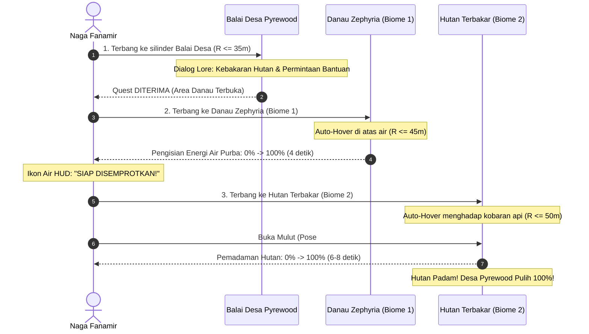

# 🎮 Spesifikasi Gameplay: Batas Dunia, Tabrakan, Alur Pyrewood, Evaluasi Positif, & Dual Input Mode
## Fanamir: The Sky Guardian *(Internal Project: AR Dragon)*

> **Dokumen Resmi Desain & Keputusan Sistem (Laptop A):**
> Dokumen ini membakukan aturan gameplay dan arsitektur sistem hasil diskusi bersama pengguna mencakup 5 keputusan penting:
> 1. **Batas Dunia (*Ocean Wind Barrier*):** Pusaran angin penghalau lembut saat naga terbang $> 1100\text{ m}$ dari pusat kepulauan.
> 2. **Fisika Tabrakan Tebing (*Glancing Bounce*):** Pantulan meluncur lembut dengan penalti momentum $50\%$ tanpa *game over* instan.
> 3. **Filosofi Time Up Exergaming Positif:** Evaluasi apresiatif *"WAKTU HABIS! USAHA YANG BAGUS!"* dengan statistik kebugaran dan tombol *RETRY*.
> 4. **Alur Misi Pyrewood 2-Tahap:** Aktivasi quest di balai desa $\to$ Sub-objektif 1 Danau (Energi Air $0\text{--}100\%$) $\to$ Sub-objektif 2 Hutan (Pemadaman $0\text{--}100\%$).
> 5. **Dual Input Mode di Settings (CV Webcam vs Keyboard):** Pemilihan mode input resmi, penyembunyian UI CV pada mode keyboard, dan penegakan blokade kalibrasi pada mode CV.
> 6. **Future Roadmap:** Perencanaan *Stage 0 (Tutorial Terpadu)* untuk fase rilis lanjutan.

---

## 🌊 1. Batas Dunia Kepulauan (*Ocean Wind Boundary Push-Back*)

Untuk menjaga naga tetap berada di area bermain kepulauan $2400 \times 2400\text{ m}$ tanpa dinding tak kasat mata yang kaku:
1. **Radius Batas:** $R_{\text{boundary}} = 1100\text{ m}$ dari pusat kepulauan `(0, 0, 0)`.
2. **Perilaku Pusaran Angin Penghalau (*Wind Wall Push-Back*):**
   - Saat jarak horizontal $XZ > 1100\text{ m}$:
     - Arah haluan naga diputar membelok halus $180^\circ$ kembali menghadap ke pusat kepulauan dalam durasi $2.5\text{ detik}$ via `Mathf.SmoothDampAngle`.
     - Tampil partikel desau angin kencang di sekeliling kamera (*Wind Gust Ribbon*).
     - Memunculkan teks peringatan ramah di layar tengah atas:
       $$\text{"Angin badai laut terlalu kuat! Kembali ke kepulauan."}$$
   - Setelah naga berbalik ke arah dalam ($XZ \le 1050\text{ m}$), kontrol kemudi kembali bebas sepenuhnya ke pemain.

---

## ⛰️ 2. Fisika Tabrakan Tebing & Tanah (*Glancing Bounce & Slip*)

Filosofi game kebugaran (*exergaming*) menghindari hukuman frustrasi (*instant death / reload*):
1. **Deteksi Benturan:** Menggunakan `OnCollisionEnter` pada collider tubuh naga terhadap layer `Terrain` dan `Rocks`.
2. **Reaksi Pantulan Meluncur (*Glancing Bounce*):**
   - Vektor kecepatan naga dipantulkan secara elastis meluncur (*reflection vector* $\vec{V}_{\text{refl}} = \text{Reflect}(\vec{V}_{\text{in}}, \vec{N}_{\text{surface}})$) dengan elevasi ke atas $+15^\circ$ agar naga tidak menancap ke tanah.
   - **Penalti Momentum:** Kecepatan dan variabel `Momentum` dipotong sebesar **$50\%$** saat benturan terjadi (menggambarkan hilangnya tenaga aerodinamis).
   - **Feedback Visual & Audio:** Sentakan kamera mikro (*camera micro-shake* $0.12\text{s}$) dan suara benturan sayap terhempas angin.
   - Naga langsung berada pada status melayang aman (*safe glide recovery*) sehingga pemain cukup mengepakkan sayap kembali untuk terbang naik.

---

## ⏳ 3. Layar Evaluasi Positif Waktu Habis (*Exergaming Positive Time-Up*)

Ketika hitungan mundur waktu stage habis (*Time Up*) dan pemain belum memulihkan cukup desa ($0$ Bintang):
1. **Bukan Layar Game Over / Defeat:** Menghilangkan kata-kata negatif seperti *"DEFEAT"*, *"YOU LOSE"*, atau *"GAME OVER"*.
2. **Judul Modal:** **"WAKTU HABIS! USAHA YANG BAGUS!"** (*"TIME UP! GREAT EFFORT!"*).
3. **Statistik Kebugaran yang Ditampilkan:**
   - Total waktu latihan fisik aktif.
   - Estimasi jumlah kepakan tangan (*total flap strokes*).
   - Progres pemulihan pulau yang berhasil dicapai (misal: *Zephyria 80% Pulih*).
4. **Tombol Tindakan:**
   - **`[ COBA LAGI (RETRY) ]`:** Mengulang stage tersebut dengan stamina segar.
   - **`[ KEMBALI KE LOBBY (ESC) ]`:** Kembali ke layar pemilihan misi.

---

## 🌲 4. Alur Misi 2-Tahap Desa Pyrewood (*Two-Stage Quest Flow*)

Misi pemadaman kebakaran hutan di Biome 2 dirancang memiliki dependensi geografis yang jelas:

### Tampilan pada `QuestObjectivePanel` (`SCREEN 02`):
Ketika misi Desa Pyrewood aktif, panel objektif menampilkan 2 baris sub-tugas berjenjang:
1. `[1] Cadangan Energi Air Purba: [0% → 100%]` *(Di Danau Zephyria)*
2. `[2] Pemadaman Hutan Membara: [0% → 100%]` *(Di Hutan Pyrewood)*

> **Aturan Gerbang (Gate Rule):** Silinder danau **TIDAK AKTIF** sebelum pemain mendatangi balai Desa Pyrewood untuk menerima misi. Hal ini menjaga koherensi naratif petualangan.

---

## 🕹️ 5. Dual Input Mode di Settings: CV Webcam vs Keyboard Mode

Untuk fleksibilitas pengujian, demonstrasi tanpa kamera, atau kondisi pencahayaan buruk, game mendukung **dua mode kontrol resmi** yang dapat diganti di menu Settings:

### 5.1. Komponen UI di `SCREEN 05` (Settings)
Menambahkan baris pengaturan kontrol:
$$\mathbf{\text{Control Input Mode:}} \quad \mathbf{[\ \text{CV (Webcam)}\ |\ \text{Keyboard}\ ]}$$
Tersimpan di `PlayerPrefs` (`Fanamir_InputControlMode`, `0 = Mode_CV`, `1 = Mode_Keyboard`).

### 5.2. Logika Operasional Tiap Mode:

| Fitur / Komponen | Mode Kontrol CV (Webcam) | Mode Kontrol Keyboard |
| :--- | :--- | :--- |
| **Kontrol Utama** | Gestur tubuh webcam via Python YOLO + MediaPipe UDP | Tombol Keyboard (W/Space Flap, S Dive, T Glide, A/D Turn, 1/2/3 Desa) |
| **Blokade Kalibrasi Stage** | **AKTIF KETAT:** Jika `IsCameraCalibrated == false`, tombol stage terkunci (`"BELUM KALIBRASI"`), dilarang masuk terbang. | **BYPASS TOTAL:** Pemain bisa langsung klik `PLAY` tanpa perlu menyalakan webcam atau kalibrasi. |
| **Klaster PIP Webcam HUD** | **TAMPIL:** Klaster kanan bawah (feed video PIP $320 \times 180$, skeleton overlay, tombol kamera) tampil normal. | **TERSEMBUNYI (HIDDEN):** Klaster PIP kamera dan telemetri webcam di-hide bersih, memperluas area pandang. |
| **Proses Python CV Latar Belakang** | Aktif memproses frame dan mengalirkan paket UDP 5052/5053. | Di-nonaktifkan / *idle* hemat daya tanpa memunculkan error socket UDP. |
| **Status Navbar Top Bar** | Menampilkan badge `CAM LIVE` / `NO CAM`. | Menampilkan badge `KEYBOARD MODE`. |

---

## 🚀 6. Future Planning: Stage 0 (Interactive Flight Tutorial)

* **Keputusan Saat Ini:** Game langsung masuk ke alur aksi Stage 1 dengan hitungan mundur `3..2..1..TERBANG!`.
* **Rencana Masa Depan (Update Lanjutan):**
  - Membuat **`Stage 0: Flight Academy`** di pulau terapung kecil khusus untuk memandu pemain berlatih 4 gerakan dasar:
    1. Cara meluncur lurus (*T-Pose Glide*).
    2. Cara mendaki (*Flap to Climb*).
    3. Cara menukik dan menambah kecepatan (*Tuck to Dive*).
    4. Cara berbelok melingkari cincin awan (*Banking Turn through Cloud Rings*).

---

*Navigasi:*
[[00 - Overview]] | [[Tasks]] | [[Devlog]] | [[gameplay-mechanics/mekanisme_tantangan_desa]] | [[ui-ux/rencana_desain_ui]]
