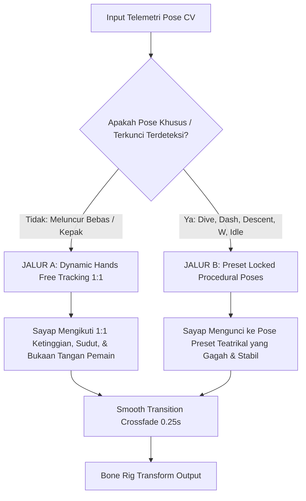

# 🐉 Planning Perbaikan Animasi & Pose Naga Fanamir

> **Tujuan Dokumen:** Menjadi cetak biru teknis komprehensif bagi perbaikan dan penyempurnaan sistem animasi naga Fanamir. Dokumen ini merespons langsung evaluasi visual dan umpan balik pengguna terkait: (1) ketiadaan animasi kaki berjalan di tanah, (2) koreksi sikap tubuh hover & elevasi dada, (3) pelacakan dinamis kepala berbasis CV, (4) pemisahan tegas sayap dinamis 1:1 vs pose khusus terkunci, (5) pengikatan posisi tangan bebas yang lebih setia, (6) perombakan kepakan bertenaga keras pada *Propeller Dash*, serta (7) standarisasi anatomi kaki saat terbang (*aerodynamic flight posture*).

---

## 🖼️ 1. Rujukan Anatomi Kaki & Sikap Terbang Resmi

Berdasarkan lembar panduan desain resmi (disimpan di [`Referensi/Ref_Dragon_Flight_Leg_Anatomy.jpg`](file:///e:/Semester%205/Game/AR%20Dragon/Referensi/Ref_Dragon_Flight_Leg_Anatomy.jpg)):


### Prinsip Anatomi Kaki Saat Terbang (*Flight Leg Posture*):
1. **Kaki Depan (*Forelegs / Front Legs*):**
   * *Status:* **Tucked backward against body / Folded neatly under chest**.
   * Siku melipat ke belakang, telapak cakar merapat rapi tepat di bawah rongga dada (*under chest gem*). Cakar menghadap ke belakang dan merapat ke perut bawah, meminimalisir profil hambatan angin depan.
2. **Kaki Belakang (*Hind Legs*):**
   * *Status:* **Extended backward, streamlined along tail / Streamlined rearward pose**.
   * Paha dan tulang kering melurus memanjang ke arah belakang, merapat sejajar di sepanjang pangkal ekor (*streamlined along tail*). Ujung cakar menunjuk ke belakang layaknya postur predator pemangsa (*bird of prey*) atau perenang air cepat.

---

## 🧭 2. Matriks 6 Pilar Pembaruan Sistem Animasi & Pose

```text
┌────────────────────────────────────────────────────────────────────────────────────────┐
│               ARSITEKTUR PERBAIKAN ANIMASI & POSE NAGA FANAMIR                         │
├─────────────────────────┬────────────────────────────┬─────────────────────────────────┤
│ PILAR 1: KAKI DI TANAH  │ PILAR 2: POSTUR HOVER      │ PILAR 3: KEPALA DINAMIS CV      │
│ • Siklus Langkah Kaki 4 │ • Dada Terangkat (+16°)    │ • Yaw, Pitch, Roll Ikuti Wajah  │
│ • Diagonal Trotting Gait│ • Buoyant Hover Bobbing    │ • Multi-Joint Neck Blend        │
│ • Sinkron walkSpeed     │ • Hover Drop Kaki Rileks   │ • SmoothDamp Bebas Jitter       │
├─────────────────────────┼────────────────────────────┼─────────────────────────────────┤
│ PILAR 4: DUAL-TRACK WING│ PILAR 5: CV HAND TRACKING  │ PILAR 6: PROPELLER DASH         │
│ • Jalur Bebas: 1:1 Tangan│ • Modulasi Wrist & Arm Open│ • Kepakan Sayap Bertenaga Keras │
│ • Jalur Khusus: Locked  │ • Rentang Jari Dinamis     │ • Amplitudo & Frekuensi Tinggi  │
│   (Dive, Dash, W, Low-A)│ • Zero Deadzone Lag        │ • Power Thrust Visual Feedback  │
└─────────────────────────┴────────────────────────────┴─────────────────────────────────┘
```

---

## 🐾 Pilar 1: Siklus Jalan 4 Kaki di Daratan (`GroundedWalk` Procedural Locomotion)

### 1.1 Masalah Saat Ini
Pada `DragonBodyAnimator.cs`, kaki naga hanya memiliki pembagian biner antara kecepatan tinggi $\ge 12\text{ m/s}$ (*Flight Tuck*) dan kecepatan rendah $< 6\text{ m/s}$ (*Hover Drop*). Ketika naga berada di tanah dan berjalan maju (*Grounded Walk*, $3.5\text{ m/s}$), keempat kaki diam menempel kaku tanpa ada siklus langkah (*walk cycle*).

### 1.2 Rancangan Solusi: *Procedural Quadruped Diagonal Gait*
Membangun siklus jalan prosedural 4 kaki berbasis *Diagonal Trotting Gait*:
* **Pasangan A:** Kaki Depan Kiri (`Leg_Front_L`) + Kaki Belakang Kanan (`Leg_Hind_R`).
* **Pasangan B:** Kaki Depan Kanan (`Leg_Front_R`) + Kaki Belakang Kiri (`Leg_Hind_L`).
* Kedua pasangan bergerak bergantian dengan beda fase $\pi\text{ rad}$ ($50\%$ siklus).

### 1.3 Formula Siklus Langkah
Parameter langkah dihitung secara kontinu berdasarkan perpindahan posisi horizontal atau kecepatan jalan di tanah:
$$\text{CycleProgress} = (\text{CycleProgress} + \text{speed} \cdot \text{stepFrequency} \cdot \Delta t) \pmod{1.0}$$
* `stepFrequency`: $\approx 1.25\text{ Hz}$ pada kecepatan nominal `walkSpeed` ($3.5\text{ m/s}$).
* **Fase Ayun (*Swing Phase*, $0.0 \le \phi < 0.5$):** Kaki terangkat dari tanah, tertekuk sedikit di sendi lutut/siku, dan melangkah ke depan:
  $$\Delta Y_{\text{lift}} = h_{\text{step}} \cdot \sin(\phi \cdot 2\pi) \quad (\text{dengan } h_{\text{step}} \approx 0.18\text{ m})$$
  $$\text{Pitch}_{\text{leg}} = \text{maxSwing} \cdot \cos(\phi \cdot 2\pi)$$
* **Fase Tumpu (*Stance Phase*, $0.5 \le \phi < 1.0$):** Kaki menapak tanah, telapak cakar rata dengan permukaan tanah, mendorong tubuh maju ke depan ($\Delta Y = 0$).

---

## 🪶 Pilar 2: Koreksi Sikap Tubuh Saat Hover (`Air Idle`) & Anatomi Terbang

### 2.1 Masalah Saat Ini
Sikap tubuh naga saat melayang diam di udara (*Hover* `#09A` / *Air Idle*) masih terlalu datar horizontal atau sedikit menunduk ke bawah, sehingga terkesan pasif dan kehilangan wibawa seekor naga penjaga langit.

### 2.2 Rancangan Sikap Hover yang Benar
1. **Elevasi Dada (*Elevated Proud Chest*):**
   * Sudut kemiringan (*pitch*) tubuh dan dada dinaikkan secara positif sebesar $+14^\circ \sim +18^\circ$ dari garis horizontal.
   * `Spine_01` dan `Spine_02` melenting anggun ke atas, memperlihatkan permata dada (*Chest Gem*) Fanamir ke arah depan-bawah.
2. **Efek Mengapung Magis (*Buoyant Hover Bobbing*):**
   * Mengaplikasikan osilasi lembut pada sumbu vertikal:
     $$Y_{\text{bob}}(t) = A_{\text{hover}} \cdot \sin(2\pi \cdot f_{\text{hover}} \cdot t)$$
     * Frekuensi: $f_{\text{hover}} \approx 0.40\text{ Hz}$.
     * Amplitudo: $A_{\text{hover}} \approx 0.22\text{ m}$.
3. **Kaki Saat Hover (*Hover Drop* Rileks):**
   * Berbeda dengan saat meluncur kencang (*Flight Tuck*), saat hover keempat kaki menjuntai turun rileks:
     * Kaki depan: tertekuk lembut sekitar $30^\circ$, cakar rileks menghadap ke bawah.
     * Kaki belakang: turun sekitar $40^\circ$ dengan lutut sedikit menekuk siap menapak daratan.
4. **Kaki Saat Meluncur Cepat (*Flight Tuck* Streamlined — Sesuai Gambar):**
   * Kaki depan melipat rapat ke belakang di bawah dada (*folded neatly under chest*).
   * Kaki belakang melurus penuh ke belakang di samping pangkal ekor (*extended backward, streamlined along tail*).

---

## 👁️ Pilar 3: Gerakan Kepala Dinamis Mengikuti CV (`DragonHeadLookController`)

### 3.1 Masalah Saat Ini
Saat ini `DragonHeadLookController` hanya memanfaatkan `HEAD_PITCH` untuk pose mendongak (*Look Up*), sehingga kepala naga belum hidup mengikuti gerakan menoleh, menggeleng, atau memiringkan kepala dari wajah pemain secara 1:1.

### 3.2 Rancangan Pelacakan Wajah 3 Sumbu Terpadu
Modul CV (`mouth_tracker.py` & `active_cv_sender.py`) mengalirkan orientasi kepala wajah pemain ke Unity:
1. **Pitch (Mendongak / Menunduk, $\pm 25^\circ$):**
   * Dihitung dari sudut kemiringan vertikal garis hidung ke dagu terhadap garis vertikal kanonik (`HEAD_PITCH`).
2. **Yaw (Menoleh Kiri / Kanan, $\pm 35^\circ$):**
   * Dihitung dari posisi relatif hidung (`Nose.x`) terhadap titik tengah kedua telinga/mata atau garis tengah bahu:
     $$\text{Yaw}_{\text{head}} = \frac{\text{Nose}_x - \text{MidShoulder}_x}{\text{ShoulderWidth}} \cdot K_{\text{yaw}}$$
3. **Roll (Kemiringan Miring Kepala, $\pm 15^\circ$):**
   * Dihitung dari kemiringan sudut garis kedua mata atau telinga pemain.

### 3.3 Distribusi Fleksi Leher Bertingkat (*Hierarchical Neck Blend*)
Rotasi kepala didistribusikan secara berjenjang ke 3 tulang leher dan kepala untuk menghasilkan kelenturan leher naga yang organik:
* `Neck_01` (Pangkal Leher): $25\%$ rotasi total.
* `Neck_02` (Tengah Leher): $35\%$ rotasi total.
* `Head` (Kepala / Tengkorak): $40\%$ rotasi total.
* Menggunakan `Mathf.SmoothDamp` ($0.10\text{--}0.14\text{ s}$) untuk meredam jitter mikro webcam tanpa menimbulkan keterlambatan respon (*zero perceived latency*).

---

## 🦅 Pilar 4: Pemisahan Arsitektur Sayap — Dynamic Free Tracking vs Locked Specific Poses

### 4.1 Prinsip Pemisahan Jalur (Dual-Track Wing Architecture)
Penyebab utama inkonsistensi animasi sayap adalah percampuran logika antara pelacakan tangan mentah (*raw hand tracking*) dengan pose-pose teatrikal game. Sistem baru memisahkan kendali sayap menjadi dua jalur yang tegas:



### 4.2 Rincian Dua Jalur

| Kategori Jalur | Daftar Pose / Status | Karakteristik Pergerakan Sayap |
| :--- | :--- | :--- |
| **JALUR A: Dynamic Free Tracking (1:1 CV)** | • **T-Pose** (Glide Meluncur)<br>• **Y-Pose** (Fly Up Naik)<br>• **Flap** (Kepakan Bebas)<br>• **Hover** (Melayang Santai) | Sayap **SETIA MENGIKUTI POSISI TANGAN PEMAIN** secara kontinu. Sudut bahu, elevasi pergelangan, dan rentang bentangan tangan langsung memetakan bentuk sayap naga secara asimetris (kiri/kanan mandiri). |
| **JALUR B: Preset Locked Poses (Spesifik)** | • **Tuck Dive** (`#13`)<br>• **Propeller Dash** (`#14`)<br>• **Gentle Descent Low-A** (`#10`)<br>• **Pose W** (`#12`)<br>• **Grounded Idle** (`#01`)<br>• **Village Actions** (`#15A..C`) | Sayap **MENGUNCI KE POSE PRESET IDEAL**. Mengabaikan goyangan tangan minor agar siluet visual tetap estetik, stabil, gagah, dan tidak terdistorsi noise sensor webcam. |

---

## ✋ Pilar 5: Dynamic Wings Movement Mengikuti Posisi Tangan Secara Nyata

### 5.1 Masalah Saat Ini
Saat pemain merentangkan tangan dalam mode jelajah bebas (Glide / Flap), naga cenderung memutar animasi sayap default alih-alih merespons ketinggian tangan pemain secara presisi.

### 5.2 Desain Pemetaan Langsung (1:1 Direct Hand-to-Wing Mapping)
Saat berada di **JALUR A**, transformasi 12 tulang sayap dihitung langsung dari keypoint pergelangan dan bahu:
1. **Elevasi Sayap Asimetris (*Independent Wing Elevation*):**
   * Ketinggian pergelangan tangan kiri `LW_Y` dan kanan `RW_Y` relatif terhadap bahu memetakan sudut angkat sayap secara mandiri:
     $$\text{ShoulderAngle}_L = \text{MapRange}(LW_y - LS_y, -0.4, +0.6, -35^\circ, +45^\circ)$$
     $$\text{ShoulderAngle}_R = \text{MapRange}(RW_y - RS_y, -0.4, +0.6, -35^\circ, +45^\circ)$$
   * Jika tangan kiri diangkat tinggi dan tangan kanan diturunkan, sayap naga kiri akan terangkat tinggi dan sayap kanan menukik turun secara asimetris sempurna.
2. **Bukaan Membran Sayap (*Wing Span & Finger Fan*):**
   * Jarak horizontal pergelangan tangan ke dada (*Arm Openness*) langsung memodulasi sudut kembang-kuncup 4 jari membran sayap (`Wing_Finger_Outer..Inner`):
     * Lengan terentang lebar $\rightarrow$ membran sayap mekar penuh $100\%$.
     * Lengan merapat ke dada $\rightarrow$ membran sayap menyempit melipat lembut.
3. **Transisi Keluar-Masuk Halus:**
   * Transisi dari Jalur A ke Jalur B (misalnya saat pemain tiba-tiba merapatkan tangan ke dada untuk Tuck Dive) menggunakan kurva `Mathf.SmoothStep` berdurasi $0.20\text{--}0.25\text{ s}$ tanpa sentakan (*zero hitch*).

---

## ⚡ Pilar 6: Overhaul Animasi `#14 Propeller Dash` — Kepakan Sayap Bertenaga Keras

### 6.1 Masalah Saat Ini
Gerakan sayap pada Propeller Dash saat ini menggunakan putaran orbital matematis halus yang menyerupai baling-baling helikopter mini, sehingga kurang memberikan sensasi kekuatan dorong kinetik naga purba yang membelah udara berkecepatan $30\text{ m/s}$.

### 6.2 Desain Baru: *High-Frequency Violent Power Flap*
Mengubah ekspresi sayap Propeller Dash menjadi **kepakan bertenaga badai super-cepat (*Violent Power Flapping*)**:
1. **Amplitudo & Kedalaman Ayunan Ekstrem:**
   * Ayunan ke atas (*upstroke*) terangkat tinggi melengkung elastis ke belakang (+Z).
   * Ayunan ke bawah (*power downstroke*) menghantam udara ke bawah dengan tenaga penuh hingga sayap hampir menyentuh batas bawah perut (sudut dorong $-45^\circ$).
2. **Frekuensi Tinggi & Sentakan Tenaga (*High-Cadence Snapping*):**
   * Frekuensi kepakan dinaikkan menjadi $\approx 3.5\text{--}4.2\text{ Hz}$ (hampir $3\times$ kecepatan kepakan normal).
   * Kurva ayunan tidak lagi sinusoidal murni, melainkan asimetris:
     * *Upstroke:* cepat dan aerodinamis ($35\%$ durasi siklus).
     * *Downstroke:* menghantam keras dengan kurva akselerasi kubik ($65\%$ durasi siklus).
3. **Distorsi Elastis Membran Sayap (*Dynamic Wing Flex*):**
   * Jari-jari sayap luar (`Wing_Finger_Outer` & `MidOuter`) melengkung tertinggal (*flex lag*) saat menghantam angin kencang, menciptakan ilusi selaput sayap yang tegang menahan tekanan udara masif.
4. **Visual & Audio Feedback Pendukung:**
   * Partikel Effekseer `VFX_Flight_SonicDashShockwave` memancar di puncak ayunan dorong.
   * Sedikit sentakan getar visual mikro (*camera micro-shake* $0.08\text{ s}$) mempertegas kedahsyatan dorongan kecepatan.

---

## 📖 3. MATRIKS SPESIFIKASI DETAIL SELURUH 19 POSE NAGA FANAMIR (47-BONE RIG)

Bagian ini merumuskan katalog matematis dan anatomi lengkap dari **ke-19 pose & manuver** naga Fanamir. Setiap pose mendefinisikan sudut rotasi Euler lokal presisi untuk ke-47 tulang rig (`ARM_Dragon`), interaksi fisika momentum, serta perilaku dinamisnya.

```text
DAFTAR 19 POSE RESMI FANAMIR:
┌─────────────────────────────────┬──────────────────────────────────┐
│ KATEGORI 1: GROUNDED (DARAT)    │ KATEGORI 2: FLIGHT & CLIMB       │
│ • #01 Grounded Idle             │ • #04 Takeoff (Flap Transition)  │
│ • #02 Grounded Walk             │ • #05 Lean & Arm Tilt (Banking)  │
│ • #03 Grounded Look Up          │ • #06 Flap to Climb (Cruise Lift)│
│                                 │ • #06B Steep Climb (Chin-Up)     │
│                                 │ • #07 Fly Up (Y-Glide Up)        │
│                                 │ • #08 Glide (Cruise T-Pose)      │
├─────────────────────────────────┼──────────────────────────────────┤
│ KATEGORI 3: SPECIAL MANEUVERS   │ KATEGORI 4: VILLAGE ACTIONS      │
│ • #09A Hover (Active Air Brake) │ • #15A Zephyria · Wind Flap      │
│ • #09B Slow Glide (L-Pose Hold) │ • #15B Pyrewood · Water Breath   │
│ • #10 Gentle Descent (Low-A)    │ • #15C Solaria · Dew Rain (11)   │
│ • #11 Fly Down (Y-Dive)         ├──────────────────────────────────┤
│ • #12 Fly Down Idle (W-Pose)    │ BASELINE: REST POSE (T-POSE)     │
│ • #13 Tuck to Dive (Bullet)     │ • 0° Euler Bind Rest Pose        │
│ • #14 Propeller Dash (Turbine)  │                                  │
└─────────────────────────────────┴──────────────────────────────────┘
```

---

### 3.1 Kategori 1: Grounded Poses (Kontrol di Permukaan Darat)

#### 1. `#01` Grounded Idle (Diam di Tanah)
* **Karakter Visual:** Naga berdiri tegak dan tenang di permukaan tanah ($0\text{ m/s}$), sayap terlipat santai di sisi tubuh, ekor beristirahat di tanah dengan osilasi bernapas halus.
* **Transformasi 47-Tulang:**
  * `Root / Pelvis`: Posisi $Y = 0.05\text{ m}$, Kemiringan Pitch $0^\circ$, Roll $0^\circ$.
  * `Spine_01 / Spine_02`: Pitch $0^\circ$ (tulang punggung lurus netral).
  * `Neck_01 / Neck_02 / Head`: Netral mendatar sejajar horizon, pandangan lurus ke depan. `Jaw`: $0^\circ$ (mulut tertutup).
  * `Kaki Depan (L/R)`: `UpperArm` $+15^\circ$, `Forearm` $-30^\circ$, `Paw` $+15^\circ$ (menjejak kokoh ke grid/tanah).
  * `Kaki Belakang (L/R)`: `Thigh` $+10^\circ$, `Shin` $-25^\circ$, `Metatarsus` $+15^\circ$, `Foot` $0^\circ$ (tegak menopang bobot panggul).
  * `Sayap (L/R)`: `Wing_Shoulder` $-75^\circ$ (menempel di rusuk), `Wing_Forearm` $+80^\circ$ (melipat ke belakang), `Wing_Fingers` merapat sejajar badan.
  * `Ekor (Tail_01..05)`: Menjuntai rileks ke tanah, ujung ekor melengkung santai $+6^\circ$.
* **Loop Dinamis:** Breathing bobbing $0.5\text{ Hz}$ (amplitudo dada $\pm 0.015\text{ m}$).

#### 2. `#02` Grounded Walk (Siklus Jalan Quadruped di Tanah)
* **Karakter Visual:** Berjalan maju di tanah dengan gaya jalan trotting diagonal quadruped ($3.5\text{ m/s}$). Pasangan kaki diagonal (Depan Kiri + Belakang Kanan) mengayun serempak, disusul pasangan (Depan Kanan + Belakang Kiri).
* **Transformasi 47-Tulang:**
  * `Root / Pelvis`: Posisi $Y = 0.05\text{ m} + \text{bobbing } \pm 0.025\text{ m}$, Roll bergoyang halus $\pm 2.5^\circ$ mengikuti langkah.
  * `Spine_01 / Spine_02`: Yaw liukan sinusoidal $\pm 3^\circ$ (tulang punggung meliuk alami mengikuti irama trotting).
  * `Neck & Head`: Kepala terangkat $+8^\circ$, anggukan counter-balance mikro berlawanan dengan langkah kaki.
  * `Kaki Depan L`: $\theta_{\text{hip}} = \sin(\phi) \times 28^\circ$, $\theta_{\text{knee}} = -\max(0, \cos(\phi)) \times 40^\circ$.
  * `Kaki Depan R`: Berlawanan fasa $180^\circ$ terhadap Kaki Depan L.
  * `Kaki Belakang L`: Mengikuti fasa Kaki Depan R (diagonal trotting).
  * `Kaki Belakang R`: Mengikuti fasa Kaki Depan L.
  * `Sayap`: Terlipat santai di samping tubuh dengan goyangan elastis mikro $\pm 4^\circ$.
  * `Ekor`: Mengayun horizontal berlawanan arah panggul (*sway damping* $0.8\text{ Hz}$).

#### 3. `#03` Grounded Look Up (Mendongak ke Langit di Darat)
* **Karakter Visual:** Badan dan kaki tetap menjejak tenang di darat, namun leher dan kepala mendongak anggun ke langit ($+35^\circ \sim +50^\circ$) memantau jalur penerbangan.
* **Transformasi 47-Tulang:**
  * `Root / Pelvis`: Tetap di tanah ($Y = 0.05\text{ m}$, Pitch $0^\circ$).
  * `Spine_01 / Spine_02`: Sedikit membusung $+6^\circ$.
  * `Neck_01`: Pitch $+18^\circ$ (lengkungan pangkal leher naik).
  * `Neck_02`: Pitch $+22^\circ$ (lengkungan leher angsa melengkung ke atas).
  * `Head`: Pitch $+15^\circ$ (total sudut dongak kepala $\sim +55^\circ$ menghadap langit).
  * `Kaki & Sayap`: Sama dengan postur `#01 Idle`.
  * `Ekor`: Ujung ekor sedikit mengibas pelan tanda kewaspadaan.

---

### 3.2 Kategori 2: Core Flight & Locomotion (Penerbangan Inti & Mengudara)

#### 4. `#04` Takeoff (Transisi Mengangkat dari Darat)
* **Karakter Visual:** Dorongan eksplosif lepas landas dari tanah ke udara: kedua sayap diayunkan kuat ke bawah, kaki mendorong lepas dari grid, badan miring naik $+25^\circ$.
* **Transformasi 47-Tulang:**
  * `Root / Pelvis`: Posisi $Y$ naik dari $0.05\text{ m} \to 0.45\text{ m}$, Pitch $+25^\circ$.
  * `Spine_01 / Spine_02`: Dada membusung $+12^\circ$.
  * `Kaki Depan`: Mendorong tanah lalu ditarik melipat ke belakang dada (`UpperArm` $+60^\circ$, `Forearm` $-80^\circ$).
  * `Kaki Belakang`: Melurus memanjang ke belakang (`Thigh` $+45^\circ$, `Shin` $-15^\circ$).
  * `Sayap`: Downstroke kuat dari $+45^\circ \to -35^\circ$, menghasilkan semburan gaya angkat vertikal.
  * `Ekor`: Melengkung ke bawah sebagai penyeimbang momen pitch takeoff.

#### 5. `#05` Lean & Arm Tilt (Kemudi Belok & Banking Roll)
* **Karakter Visual:** Belok tajam berkecepatan tinggi: badan naga melakukan banking roll ($\pm 25^\circ \sim \pm 35^\circ$) dan yaw belok. Sayap sisi dalam turun, sayap sisi luar naik, ekor mengimbangi ke arah luar layaknya sirip kemudi (*rudder*).
* **Transformasi 47-Tulang:**
  * `Root / Pelvis`: Roll miring $\pm 30^\circ$, Yaw belok mengikuti arah tangan pemain.
  * `Spine_01 / Spine_02`: Meliuk lateral (Yaw) $\pm 10^\circ$ ke arah belokan.
  * `Sayap Sisi Dalam`: Tertekan ke bawah (`Wing_Shoulder` $-20^\circ$).
  * `Sayap Sisi Luar`: Terangkat naik tinggi (`Wing_Shoulder` $+35^\circ$).
  * `Kaki Depan & Belakang`: Terlipat rapi aerodinamis mengikuti poros tubuh miring.
  * `Ekor`: Meliuk kuat ke arah luar radius belokan ($\pm 25^\circ$) sebagai penyeimbang sentrifugal.

#### 6. `#06` Flap to Climb (Menanjak Landai Ritmis)
* **Karakter Visual:** Mengudara sambil menanjak landai ($+3.5\text{ m/s}$): sayap mengepak ritmis mengayun penuh ($1.2\text{ Hz}$), badan mendongak lembut $+12^\circ$.
* **Transformasi 47-Tulang:**
  * `Root / Pelvis`: Pitch $+12^\circ$, bobbing vertikal mengikuti kepakan.
  * `Spine_01 / Spine_02`: Pitch $+8^\circ$.
  * `Kaki Depan`: Terlipat rapi di rongga dada (*tucked*).
  * `Kaki Belakang`: Lurus memanjang ke belakang sejajar ekor.
  * `Sayap`: Siklus flap sinusoidal $-25^\circ \dots +40^\circ$ dengan elastisitas ujung jari sayap.
  * `Ekor`: Mengimbangi ayunan kepakan secara ritmis.

#### 7. `#06B` Steep Climb (Menanjak Curam / Chin-Up Flap)
* **Karakter Visual:** Manuver darurat menanjak curam ($+7.0\text{ m/s}$) melewati tebing tinggi: kepala mendongak tajam, dada terangkat tinggi $+24^\circ$, badan condong tegak $+40^\circ$, kepakan sayap bertenaga penuh.
* **Transformasi 47-Tulang:**
  * `Root / Pelvis`: Pitch $+40^\circ$ curam.
  * `Spine_01 / Spine_02`: Dada terangkat maksimal $+24^\circ$.
  * `Neck & Head`: Kepala mendongak $+25^\circ$ melihat puncak tebing.
  * `Kaki Depan & Belakang`: Rapat ketat ke tubuh meminimalkan drag vertikal.
  * `Sayap`: Kepakan sayap frekuensi tinggi ($2.2\text{ Hz}$) dengan sudut serang (*angle of attack*) curam.
  * `Ekor`: Melengkung tajam ke bawah menahan momen angkat.

#### 8. `#07` Fly Up (Y-Glide Up Berbasis Momentum)
* **Karakter Visual:** Meluncur menanjak ke angkasa memanfaatkan momentum cadangan: sayap naga membentuk **dihedral huruf Y yang megah (~$45^\circ$ di atas horizon)**, badan condong naik $+30^\circ$, meluncur mulus tanpa mengepak. Jika momentum habis ($0\%$), naga mengalami *gentle stall* (hidung turun landai $-1.2\text{ m/s}$).
* **Transformasi 47-Tulang:**
  * `Root / Pelvis`: Pitch $+30^\circ$ (saat momentum $>0\%$) $\to -5^\circ$ (saat stall).
  * `Spine_01 / Spine_02`: Pitch $+14^\circ$.
  * `Sayap (L/R)`: `Wing_Shoulder` $+38^\circ$, `Wing_Forearm` $+15^\circ$ (membentuk siluet huruf Y megah simetris).
  * `Kaki Depan`: Rapat di dada (`UpperArm` $+50^\circ$, `Forearm` $-75^\circ$).
  * `Kaki Belakang`: Lurus sejajar ekor (`Thigh` $+55^\circ$, `Shin` $-20^\circ$).
  * `Ekor`: Melengkung lembut $+12^\circ$ mengalir di belakang.

#### 9. `#08` Glide (Cruise Flight T-Pose)
* **Karakter Visual:** Mode terbang jelajah standar berkecepatan tinggi ($14\text{--}27\text{ m/s}$): kedua sayap membentang horizontal penuh $180^\circ$ membentuk huruf **T datar sempurna**, badan mendatar streamline ($0^\circ$), kaki depan melipat di dada, kaki belakang lurus memanjang ke ekor.
* **Transformasi 47-Tulang:**
  * `Root / Pelvis`: Pitch $0^\circ$, Roll $0^\circ$, Yaw $0^\circ$.
  * `Spine_01 / Spine_02`: Pitch $0^\circ$ (punggung lurus aerodinamis).
  * `Neck & Head`: Lurus ke depan sejajar arah terbang.
  * `Kaki Depan`: `UpperArm` $+45^\circ$, `Forearm` $-75^\circ$, `Paw` $+20^\circ$ (terlipat rapi di bawah dada).
  * `Kaki Belakang`: `Thigh` $+65^\circ$, `Shin` $-25^\circ$, `Metatarsus` $+15^\circ$, `Foot` $0^\circ$ (memanjang lurus ke belakang sejajar ekor).
  * `Sayap (L/R)`: `Wing_Shoulder` $0^\circ$, `Wing_Forearm` $0^\circ$, `Wing_Fingers` terbuka rata mendatar $180^\circ$.
  * `Ekor`: Lurus ke belakang dengan gelombang osilasi kemudi mikro $\pm 1.5^\circ$.

---

### 3.3 Kategori 3: Special Maneuvers & Hover (Manuver Khusus & Pengereman)

#### 10. `#09A` Hover (Stationary Flight — Active Air Brake)
* **Karakter Visual:** Melayang diam di tempat ($0\text{ m/s}$): tubuh tegap condong naik $+30^\circ$, dada terangkat $+16^\circ$ memperlihatkan permata dada (*chest gem*), sayap mengepak santai/flutter di ketinggian dada, kaki depan tertekuk rileks menggantung ke bawah-depan, kaki belakang melayang bebas tertekuk di bawah tubuh, ekor melengkung anggun ke atas sebagai penyeimbang bobot.
* **Transformasi 47-Tulang:**
  * `Root / Pelvis`: Posisi $Y = 0.45\text{ m} + \sin(t \times 2.5) \times 0.08\text{ m}$, Pitch $+30^\circ$ tegap.
  * `Spine_01 / Spine_02`: Pitch $-16^\circ$ (dada membusung bangga).
  * `Neck & Head`: Counter-leveling horizontal sejajar mata penonton.
  * `Kaki Depan`: `UpperArm` $+45^\circ$, `Forearm` $-70^\circ$, `Paw` $+20^\circ$ (menjuntai santai di bawah dada).
  * `Kaki Belakang`: `Thigh` $+40^\circ$, `Shin` $-25^\circ$, `Metatarsus` $+20^\circ$, `Foot` $+15^\circ$ (melayang bebas di bawah tubuh, siap mendarat).
  * `Sayap`: Ayunan kepakan flutter lembut frekuensi $1.4\text{ Hz}$ (amplitudo $\pm 18^\circ$).
  * `Ekor`: Melengkung anggun ke atas ($+18^\circ$) sebagai penyeimbang bobot.

#### 11. `#09B` Slow Glide (L-Pose Hold)
* **Karakter Visual:** Meluncur santai berkecepatan rendah ($\sim 6\text{--}8\text{ m/s}$): sayap tertekuk santai membentuk siluet semi-L, badan sedikit condong $+8^\circ$, kaki terlipat rileks.
* **Transformasi 47-Tulang:**
  * `Root / Pelvis`: Pitch $+8^\circ$.
  * `Spine_01 / Spine_02`: Pitch $+4^\circ$.
  * `Sayap (L/R)`: `Wing_Shoulder` $-15^\circ$, `Wing_Forearm` $+35^\circ$ (posisi semi-L tertahan tenang).
  * `Kaki Depan & Belakang`: Terlipat rileks di bawah perut.
  * `Ekor`: Mengalir santai di belakang.

#### 12. `#10` Gentle Descent (Low-A Pose)
* **Karakter Visual:** Meluncur turun perlahan dan terkontrol menuju daratan: kedua sayap lurus mengarah serong bawah membentuk huruf **A rendah (~$35^\circ$ di bawah horizontal)**, hidung sedikit menunduk landai, kaki mulai bersiap menjulur ke bawah (*landing gear preparation*).
* **Transformasi 47-Tulang:**
  * `Root / Pelvis`: Pitch $-8^\circ$ (menunduk landai turun).
  * `Spine_01 / Spine_02`: Pitch $-4^\circ$.
  * `Sayap (L/R)`: `Wing_Shoulder` $-35^\circ$, `Wing_Forearm` $-10^\circ$ (membentuk huruf A rendah).
  * `Kaki Depan`: Mulai membuka ke bawah (`UpperArm` $+30^\circ$, `Forearm` $-40^\circ$).
  * `Kaki Belakang`: Mulai menjulur ke bawah (`Thigh` $+25^\circ$, `Shin` $-30^\circ$).
  * `Ekor`: Melengkung stabil $+10^\circ$.

#### 13. `#11` Fly Down (Y-Dive)
* **Karakter Visual:** Menukik turun diagonal terkendali sambil tetap mempertahankan laju maju sedang: lengan sayap atas mendatar setinggi bahu, siku sayap tertekuk ke atas-luar membentuk huruf **Y bersiku lebar**.
* **Transformasi 47-Tulang:**
  * `Root / Pelvis`: Pitch $-22^\circ$.
  * `Spine_01 / Spine_02`: Pitch $-10^\circ$.
  * `Sayap (L/R)`: `Wing_Shoulder` $+10^\circ$, `Wing_Forearm` $+45^\circ$, `Wing_Fingers` terbuka serong atas.
  * `Kaki Depan & Belakang`: Terlipat rapat aerodinamis.
  * `Ekor`: Lurus kencang di belakang.

#### 14. `#12` Fly Down Idle (W-Pose / Vertical Elevator)
* **Karakter Visual:** Turun vertikal di tempat layaknya lift udara (*vertical elevator descent*): sayap ditekuk turun rendah di pinggang lalu ujung sayap mengarah vertikal ke atas membentuk huruf **W** yang tegas.
* **Transformasi 47-Tulang:**
  * `Root / Pelvis`: Pitch $+15^\circ$ (menahan laju maju).
  * `Spine_01 / Spine_02`: Pitch $+8^\circ$.
  * `Sayap (L/R)`: `Wing_Shoulder` $-40^\circ$ (siku turun), `Wing_Forearm` $+85^\circ$ (lengan bawah tegak lurus ke atas membentuk huruf W).
  * `Kaki Depan & Belakang`: Menjuntai vertikal ke bawah menahan angin.
  * `Ekor`: Melengkung tajam ke bawah membantu pengereman udara vertikal.

#### 15. `#13` Tuck to Dive (Bullet Dive Boost)
* **Karakter Visual:** Menukik curam berkecepatan tinggi supersonik ($>35\text{ m/s}$): badan menukik tajam ke bawah ($-45^\circ \sim -60^\circ$), sayap terlipat rapat menempel ke rusuk dan punggung (*aerodynamic dart/bullet shape*), kaki merapat ketat ke tubuh, kepala menukik tajam ke pusat bumi.
* **Transformasi 47-Tulang:**
  * `Root / Pelvis`: Pitch $-45^\circ$ tajam.
  * `Spine_01 / Spine_02`: Punggung melengkung aerodinamis $-15^\circ$.
  * `Neck & Head`: Menunduk tajam $-25^\circ$.
  * `Sayap (L/R)`: `Wing_Shoulder` $-70^\circ$, `Wing_Forearm` $+75^\circ$, `Wing_Fingers` merapat lurus ke belakang sejajar rusuk (profil hambatan angin minimum).
  * `Kaki Depan`: Terkunci rapat di rongga dada (`UpperArm` $+70^\circ$, `Forearm` $-85^\circ$).
  * `Kaki Belakang`: Terkunci kencang di pangkal ekor (`Thigh` $+75^\circ$, `Shin` $-10^\circ$).
  * `Ekor`: Lurus kaku sejajar arah menukik, membelah angin.

#### 16. `#14` Propeller Dash (Turbine Dash Impulse)
* **Karakter Visual:** Lonjakan akselerasi instan supersonik: kedua sayap mengepak dan berputar sangat cepat dan agresif dengan frekuensi tinggi ($3.8\text{ Hz}$), badan sedikit menukik maju ($-8^\circ$), selaput sayap bergetar elastis, kaki terkunci kencang ke belakang.
* **Transformasi 47-Tulang:**
  * `Root / Pelvis`: Pitch $-8^\circ$, getaran mikro frekuensi tinggi ($7.0\text{ Hz}$).
  * `Spine_01 / Spine_02`: Tegak kokoh mengunci torsi sayap.
  * `Sayap (L/R)`: Ayunan kepakan orbit asimetris super-cepat ($3.8\text{ Hz}$, amplitudo $-35^\circ \dots +55^\circ$), dengan kurva akselerasi downstroke eksponensial. Jari-jari sayap melengkung tertinggal (*flex lag*).
  * `Kaki Depan & Belakang`: Terkunci rapat di belakang aerodinamis.
  * `Ekor`: Lurus kencang mengimbangi hembusan turbulensi udara belakang.

---

### 3.4 Kategori 4: Village Actions (Aksi Ritual Pemulihan 3 Desa)

#### 17. `#15A` Zephyria · Wind Flap (Pembersih Polusi Biome 1)
* **Karakter Visual:** Sapuan kepakan sayap raksasa ke bawah (*sweeping downward power flap*): kedua sayap diangkat tinggi ke atas lalu dihempaskan sekuat tenaga ke bawah-samping paha untuk menghembuskan kabut polusi beracun di Desa Zephyria.
* **Transformasi 47-Tulang:**
  * `Root / Pelvis`: Pitch $+20^\circ$ saat downstroke menghantam angin.
  * `Spine_01 / Spine_02`: Membusung memompa tenaga $+18^\circ$.
  * `Sayap (L/R)`: Siklus sapuan kuat: mulai dari `Wing_Shoulder` $+65^\circ$ (terangkat sangat tinggi) lalu menghantam turun cepat ke $-45^\circ$ (menyapu ke sisi paha).
  * `Kaki Depan & Belakang`: Menggantung kokoh menahan hentakan udara.
  * `Ekor`: Mengibas ke bawah sinkron dengan hantaman sayap.

#### 18. `#15B` Pyrewood · Open Mouth (Water Breath Stream Biome 2)
* **Karakter Visual:** Semburan nafas air purba untuk memadamkan kebakaran hutan: tubuh naga melayang tenang stabil, rahang bawah (`Jaw`) terbuka lebar ($0^\circ \to -30^\circ$), leher menjulur lurus ke depan, ekor mengimbangi semburan air purba yang memancar dari mulut.
* **Transformasi 47-Tulang:**
  * `Root / Pelvis`: Pitch $+10^\circ$ (posisi melayang stabil).
  * `Spine_01 / Spine_02`: Dada membusung $+12^\circ$.
  * `Neck_01 / Neck_02`: Menjulur lurus ke depan mengarahkan nozzle semburan air.
  * `Head`: Pitch $0^\circ$ (fokus ke target kebakaran).
  * **`Jaw`**: Rotasi Euler Pitch **$-30^\circ$ terbuka lebar** (mulut naga menganga penuh mengalirkan semburan air purba).
  * `Sayap`: Kepakan penyeimbang melayang lembut di tempat.
  * `Ekor`: Melengkung anggun ke atas menahan recoil gaya dorong air.

#### 19. `#15C` Solaria · Dew Rain (Ritual Hujan Embun Double I-Pose "11" Biome 3)
* **Karakter Visual:** Ritual pemanggilan hujan embun suci untuk menyembuhkan kekeringan kristal: kedua sayap diangkat **lurus vertikal sejajar ke atas langit membentuk angka `11`** (*Double I-Pose*, rentang sayap sempit di kanan-kiri kepala), kepala mendongak khidmat ke langit keemasan, dada membusung agung, kaki menjuntai tenang.
* **Transformasi 47-Tulang:**
  * `Root / Pelvis`: Pitch $+25^\circ$ khidmat.
  * `Spine_01 / Spine_02`: Dada membusung agung $+20^\circ$ memperlihatkan kilau permata dada.
  * `Neck & Head`: Kepala mendongak ke atas langit $+28^\circ$.
  * `Sayap (L/R)`: `Wing_Shoulder` $+80^\circ$ lurus tegak ke atas, `Wing_Forearm` $0^\circ$, `Wing_Fingers` merapat lurus ke atas langit membentuk siluet angka `11` sejajar.
  * `Kaki Depan`: Menjuntai anggun rileks ke bawah.
  * `Kaki Belakang`: Menjuntai santai di bawah tubuh.
  * `Ekor`: Melengkung anggun ke atas membentuk kurva sabit magis.

---

### 3.5 Matriks Komparasi Sudut Rotasi 47 Tulang (Ringkasan C#)

| ID | Nama Pose | Body Pitch | Chest Elev | Forelegs | Hindlegs | Head Pitch | Wing Mode | Tail Curve |
| :--- | :--- | :---: | :---: | :---: | :---: | :---: | :--- | :---: |
| **`#01`** | Grounded Idle | $0^\circ$ | $0^\circ$ | $+15^\circ$ | $+10^\circ$ | $0^\circ$ | Folded Sides | $+6^\circ$ |
| **`#02`** | Grounded Walk | $0^\circ$ | $0^\circ$ | Trotting | Trotting | $+8^\circ$ | Folded Sides | $\pm 5^\circ$ |
| **`#03`** | Grounded Look Up | $0^\circ$ | $+6^\circ$ | $+15^\circ$ | $+10^\circ$ | $+35^\circ$ | Folded Sides | $+6^\circ$ |
| **`#04`** | Takeoff | $+25^\circ$ | $+12^\circ$ | $+60^\circ$ | $+45^\circ$ | $+10^\circ$ | Downstroke | $-15^\circ$ |
| **`#05`** | Lean & Turn | $0^\circ$ (Roll $30^\circ$) | $0^\circ$ | $-45^\circ$ | $-65^\circ$ | Tilt $15^\circ$ | Bank Asym | Rudder $25^\circ$ |
| **`#06`** | Flap to Climb | $+12^\circ$ | $+8^\circ$ | $-45^\circ$ | $-65^\circ$ | $+5^\circ$ | Flap $1.2\text{ Hz}$ | $+8^\circ$ |
| **`#06B`**| Steep Climb | $+40^\circ$ | $+24^\circ$ | $-60^\circ$ | $-70^\circ$ | $+25^\circ$ | Flap $2.2\text{ Hz}$ | $-20^\circ$ |
| **`#07`** | Fly Up (Y-Pose)| $+30^\circ$ | $+14^\circ$ | $-50^\circ$ | $-65^\circ$ | $+12^\circ$ | **Y-Dihedral $45^\circ$** | $+12^\circ$ |
| **`#08`** | Cruise Glide | $0^\circ$ | $0^\circ$ | $-45^\circ$ | $-65^\circ$ | $0^\circ$ | **T-Pose $180^\circ$** | $0^\circ$ |
| **`#09A`**| Hover Active | $+30^\circ$ | $+16^\circ$ | $+85^\circ$ | $+40^\circ$ | $0^\circ$ | Flutter $1.4\text{ Hz}$ | $+18^\circ$ |
| **`#09B`**| Slow Glide | $+8^\circ$ | $+4^\circ$ | $+30^\circ$ | $+20^\circ$ | $0^\circ$ | Semi-L Pose | $+8^\circ$ |
| **`#10`** | Gentle Descent | $-8^\circ$ | $-4^\circ$ | $+30^\circ$ | $+25^\circ$ | $-4^\circ$ | **Low-A $35^\circ$** | $+10^\circ$ |
| **`#11`** | Fly Down Y-Dive | $-22^\circ$ | $-10^\circ$ | $-45^\circ$ | $-65^\circ$ | $-12^\circ$ | Wide Y-Dive | $+5^\circ$ |
| **`#12`** | W-Pose Elevator | $+15^\circ$ | $+8^\circ$ | $+70^\circ$ | $+50^\circ$ | $0^\circ$ | **Full W-Pose** | $-15^\circ$ |
| **`#13`** | Tuck to Dive | $-45^\circ$ | $-15^\circ$ | $-85^\circ$ | $-75^\circ$ | $-25^\circ$ | **Tucked Bullet** | $0^\circ$ |
| **`#14`** | Propeller Dash | $-8^\circ$ | $+4^\circ$ | $-70^\circ$ | $-70^\circ$ | $0^\circ$ | **Turbine $3.8\text{ Hz}$**| $0^\circ$ |
| **`#15A`**| Zephyria Wind | $+20^\circ$ | $+18^\circ$ | $+40^\circ$ | $+30^\circ$ | $+5^\circ$ | Down Sweep | $-10^\circ$ |
| **`#15B`**| Pyrewood Breath| $+10^\circ$ | $+12^\circ$ | $+50^\circ$ | $+35^\circ$ | $0^\circ$ (Jaw $-30^\circ$)| Hovering Flap | $+15^\circ$ |
| **`#15C`**| Solaria Dew Rain| $+25^\circ$ | $+20^\circ$ | $+60^\circ$ | $+40^\circ$ | $+28^\circ$ | **Double I "11"** | $+22^\circ$ |
| **REST** | Bind T-Pose | $0^\circ$ | $0^\circ$ | $0^\circ$ | $0^\circ$ | $0^\circ$ | Bind Rest ($0^\circ$) | $0^\circ$ |

---

## 📋 4. Matriks Komparasi: Status Eksisting vs Rencana Baru

| Komponen Rig | Status Eksisting | Rencana Peningkatan Baru | File Terkait di Unity |
| :--- | :--- | :--- | :--- |
| **Kaki (Ground Walk)** | Diam menapak kaku saat jalan | Siklus jalan 4 kaki prosedural (*diagonal trotting gait*, ayun + tumpu) | `DragonBodyAnimator.cs` |
| **Kaki (Flight)** | Menjuntai atau lipatan generik | Kaki depan melipat rapi di bawah dada, kaki belakang lurus di samping ekor | `DragonBodyAnimator.cs` |
| **Tubuh (Hover)** | Tubuh datar / sedikit menunduk | Dada terangkat tegap ($+16^\circ$), osilasi apung magis vertikal, kaki rileks | `DragonBodyAnimator.cs`, `DragonFlightController.cs` |
| **Kepala & Leher** | Hanya merespons `HEAD_PITCH` | Pelacakan dinamis 3 sumbu (Yaw, Pitch, Roll) terdistribusi ke 3 tulang leher | `DragonHeadLookController.cs` |
| **Sayap (Bebas)** | Menggunakan animasi template baku | Dynamic Tracking 1:1 setia mengikuti ketinggian & bukaan tangan pemain | `DragonWingAnimator.cs` |
| **Sayap (Khusus)** | Berbaur dengan pelacakan tangan | Preset Locked: Mengunci ke pose estetis gagah (Tuck Dive, W, Low-A, dll.) | `DragonWingAnimator.cs` |
| **Propeller Dash** | Putaran orbital kuadratur halus | Kepakan bertenaga badai super-cepat ($3.8\text{ Hz}$), ayunan dalam, elastis | `DragonWingAnimator.cs` |

---

## 🚀 4. Rencana Kerja & Langkah Eksekusi (Action Items)

### Tahap 1: Persiapan & Sinkronisasi Laptop A (Sesi Ini)
- [x] Menyusun dokumen perencanaan detail `planning_perbaikan_animasi_dan_pose.md`.
- [x] Mengarsipkan rujukan gambar anatomi kaki ke [`Referensi/Ref_Dragon_Flight_Leg_Anatomy.jpg`](file:///e:/Semester%205/Game/AR%20Dragon/Referensi/Ref_Dragon_Flight_Leg_Anatomy.jpg).
- [ ] Menyusun Master Prompt Eksekusi siap pakai untuk Laptop B.
- [ ] Memperbarui catatan pelacakan di [[Tasks]] dan [[Devlog]].

### Tahap 2: Eksekusi Kode di Laptop B
1. **Pembaruan `DragonBodyAnimator.cs`:**
   - Menambahkan algoritma siklus langkah quadruped `UpdateGroundedWalkCycle()`.
   - Mengoreksi rotasi lokal kaki depan (*tucked under chest*) dan kaki belakang (*extended along tail*).
   - Menambahkan elevasi dada pada state Hover ($+16^\circ$).
2. **Pembaruan `DragonHeadLookController.cs`:**
   - Mengintegrasikan pembacaan Yaw dan Roll kepala wajah dari CV dan mendistribusikannya ke `Neck_01`, `Neck_02`, dan `Head`.
3. **Pembaruan `DragonWingAnimator.cs`:**
   - Memisahkan logika eksekusi menjadi `UpdateDynamicFreeWingTracking()` (Jalur A) dan `UpdatePresetLockedWingPose()` (Jalur B).
   - Mengimplementasikan gerakan kepakan agresif bertenaga tinggi untuk `#14 Propeller Dash`.
4. **Verifikasi Play Mode:**
   - Menjalankan scene `MainIsland_Gameplay.unity` dan memeriksa respon visual kamera di Play Mode.

---

*Navigasi Vault:* [[00 - Overview]] | [[Tasks]] | [[Devlog]] | [[visual-vfx/arsitektur_animasi_naga_fanamir]] | [[visual-vfx/prompt_eksekusi_animasi_naga_laptop_b]]
