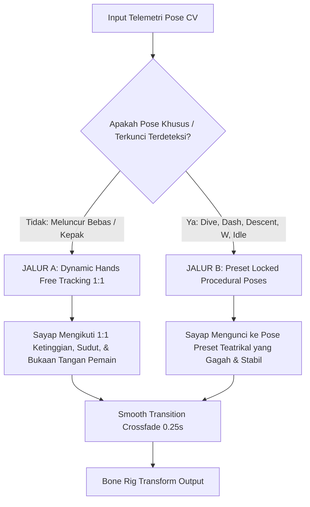

# 🐉 Planning Perbaikan Animasi & Pose Naga Fanamir

> **Tujuan Dokumen:** Menjadi cetak biru teknis komprehensif bagi perbaikan dan penyempurnaan sistem animasi naga Fanamir. Dokumen ini merespons langsung evaluasi visual dan umpan balik pengguna terkait: (1) ketiadaan animasi kaki berjalan di tanah, (2) koreksi sikap tubuh hover & elevasi dada, (3) pelacakan dinamis kepala berbasis CV, (4) pemisahan tegas sayap dinamis 1:1 vs pose khusus terkunci, (5) pengikatan posisi tangan bebas yang lebih setia, (6) perombakan kepakan bertenaga keras pada *Propeller Dash*, serta (7) standarisasi anatomi kaki saat terbang (*aerodynamic flight posture*).

---

## 🖼️ 1. Rujukan Anatomi Kaki & Sikap Terbang Resmi

Berdasarkan lembar panduan desain resmi (disimpan di [`Referensi/Ref_Dragon_Flight_Leg_Anatomy.jpg`](file:///e:/Semester%205/Game/AR%20Dragon/Referensi/Ref_Dragon_Flight_Leg_Anatomy.jpg)):


### Prinsip Anatomi Kaki Saat Terbang (*Flight Leg Posture*):
1. **Kaki Depan (*Forelegs / Front Legs*):**
   * *Status:* **Tucked backward against body / Folded neatly under chest**.
   * Siku melipat ke belakang, telapak cakar merapat rapi tepat di bawah rongga dada (*under chest gem*). Cakar menghadap ke belakang dan merapat ke perut bawah, meminimalisir profil hambatan angin depan.
2. **Kaki Belakang (*Hind Legs*):**
   * *Status:* **Extended backward, streamlined along tail / Streamlined rearward pose**.
   * Paha dan tulang kering melurus memanjang ke arah belakang, merapat sejajar di sepanjang pangkal ekor (*streamlined along tail*). Ujung cakar menunjuk ke belakang layaknya postur predator pemangsa (*bird of prey*) atau perenang air cepat.

---

## 🧭 2. Matriks 6 Pilar Pembaruan Sistem Animasi & Pose

```text
┌────────────────────────────────────────────────────────────────────────────────────────┐
│               ARSITEKTUR PERBAIKAN ANIMASI & POSE NAGA FANAMIR                         │
├─────────────────────────┬────────────────────────────┬─────────────────────────────────┤
│ PILAR 1: KAKI DI TANAH  │ PILAR 2: POSTUR HOVER      │ PILAR 3: KEPALA DINAMIS CV      │
│ • Siklus Langkah Kaki 4 │ • Dada Terangkat (+16°)    │ • Yaw, Pitch, Roll Ikuti Wajah  │
│ • Diagonal Trotting Gait│ • Buoyant Hover Bobbing    │ • Multi-Joint Neck Blend        │
│ • Sinkron walkSpeed     │ • Hover Drop Kaki Rileks   │ • SmoothDamp Bebas Jitter       │
├─────────────────────────┼────────────────────────────┼─────────────────────────────────┤
│ PILAR 4: DUAL-TRACK WING│ PILAR 5: CV HAND TRACKING  │ PILAR 6: PROPELLER DASH         │
│ • Jalur Bebas: 1:1 Tangan│ • Modulasi Wrist & Arm Open│ • Kepakan Sayap Bertenaga Keras │
│ • Jalur Khusus: Locked  │ • Rentang Jari Dinamis     │ • Amplitudo & Frekuensi Tinggi  │
│   (Dive, Dash, W, Low-A)│ • Zero Deadzone Lag        │ • Power Thrust Visual Feedback  │
└─────────────────────────┴────────────────────────────┴─────────────────────────────────┘
```

---

## 🐾 Pilar 1: Siklus Jalan 4 Kaki di Daratan (`GroundedWalk` Procedural Locomotion)

### 1.1 Masalah Saat Ini
Pada `DragonBodyAnimator.cs`, kaki naga hanya memiliki pembagian biner antara kecepatan tinggi $\ge 12\text{ m/s}$ (*Flight Tuck*) dan kecepatan rendah $< 6\text{ m/s}$ (*Hover Drop*). Ketika naga berada di tanah dan berjalan maju (*Grounded Walk*, $3.5\text{ m/s}$), keempat kaki diam menempel kaku tanpa ada siklus langkah (*walk cycle*).

### 1.2 Rancangan Solusi: *Procedural Quadruped Diagonal Gait*
Membangun siklus jalan prosedural 4 kaki berbasis *Diagonal Trotting Gait*:
* **Pasangan A:** Kaki Depan Kiri (`Leg_Front_L`) + Kaki Belakang Kanan (`Leg_Hind_R`).
* **Pasangan B:** Kaki Depan Kanan (`Leg_Front_R`) + Kaki Belakang Kiri (`Leg_Hind_L`).
* Kedua pasangan bergerak bergantian dengan beda fase $\pi\text{ rad}$ ($50\%$ siklus).

### 1.3 Formula Siklus Langkah
Parameter langkah dihitung secara kontinu berdasarkan perpindahan posisi horizontal atau kecepatan jalan di tanah:
$$\text{CycleProgress} = (\text{CycleProgress} + \text{speed} \cdot \text{stepFrequency} \cdot \Delta t) \pmod{1.0}$$
* `stepFrequency`: $\approx 1.25\text{ Hz}$ pada kecepatan nominal `walkSpeed` ($3.5\text{ m/s}$).
* **Fase Ayun (*Swing Phase*, $0.0 \le \phi < 0.5$):** Kaki terangkat dari tanah, tertekuk sedikit di sendi lutut/siku, dan melangkah ke depan:
  $$\Delta Y_{\text{lift}} = h_{\text{step}} \cdot \sin(\phi \cdot 2\pi) \quad (\text{dengan } h_{\text{step}} \approx 0.18\text{ m})$$
  $$\text{Pitch}_{\text{leg}} = \text{maxSwing} \cdot \cos(\phi \cdot 2\pi)$$
* **Fase Tumpu (*Stance Phase*, $0.5 \le \phi < 1.0$):** Kaki menapak tanah, telapak cakar rata dengan permukaan tanah, mendorong tubuh maju ke depan ($\Delta Y = 0$).

---

## 🪶 Pilar 2: Koreksi Sikap Tubuh Saat Hover (`Air Idle`) & Anatomi Terbang

### 2.1 Masalah Saat Ini
Sikap tubuh naga saat melayang diam di udara (*Hover* `#09A` / *Air Idle*) masih terlalu datar horizontal atau sedikit menunduk ke bawah, sehingga terkesan pasif dan kehilangan wibawa seekor naga penjaga langit.

### 2.2 Rancangan Sikap Hover yang Benar
1. **Elevasi Dada (*Elevated Proud Chest*):**
   * Sudut kemiringan (*pitch*) tubuh dan dada dinaikkan secara positif sebesar $+14^\circ \sim +18^\circ$ dari garis horizontal.
   * `Spine_01` dan `Spine_02` melenting anggun ke atas, memperlihatkan permata dada (*Chest Gem*) Fanamir ke arah depan-bawah.
2. **Efek Mengapung Magis (*Buoyant Hover Bobbing*):**
   * Mengaplikasikan osilasi lembut pada sumbu vertikal:
     $$Y_{\text{bob}}(t) = A_{\text{hover}} \cdot \sin(2\pi \cdot f_{\text{hover}} \cdot t)$$
     * Frekuensi: $f_{\text{hover}} \approx 0.40\text{ Hz}$.
     * Amplitudo: $A_{\text{hover}} \approx 0.22\text{ m}$.
3. **Kaki Saat Hover (*Hover Drop* Rileks):**
   * Berbeda dengan saat meluncur kencang (*Flight Tuck*), saat hover keempat kaki menjuntai turun rileks:
     * Kaki depan: tertekuk lembut sekitar $30^\circ$, cakar rileks menghadap ke bawah.
     * Kaki belakang: turun sekitar $40^\circ$ dengan lutut sedikit menekuk siap menapak daratan.
4. **Kaki Saat Meluncur Cepat (*Flight Tuck* Streamlined — Sesuai Gambar):**
   * Kaki depan melipat rapat ke belakang di bawah dada (*folded neatly under chest*).
   * Kaki belakang melurus penuh ke belakang di samping pangkal ekor (*extended backward, streamlined along tail*).

---

## 👁️ Pilar 3: Gerakan Kepala Dinamis Mengikuti CV (`DragonHeadLookController`)

### 3.1 Masalah Saat Ini
Saat ini `DragonHeadLookController` hanya memanfaatkan `HEAD_PITCH` untuk pose mendongak (*Look Up*), sehingga kepala naga belum hidup mengikuti gerakan menoleh, menggeleng, atau memiringkan kepala dari wajah pemain secara 1:1.

### 3.2 Rancangan Pelacakan Wajah 3 Sumbu Terpadu
Modul CV (`mouth_tracker.py` & `active_cv_sender.py`) mengalirkan orientasi kepala wajah pemain ke Unity:
1. **Pitch (Mendongak / Menunduk, $\pm 25^\circ$):**
   * Dihitung dari sudut kemiringan vertikal garis hidung ke dagu terhadap garis vertikal kanonik (`HEAD_PITCH`).
2. **Yaw (Menoleh Kiri / Kanan, $\pm 35^\circ$):**
   * Dihitung dari posisi relatif hidung (`Nose.x`) terhadap titik tengah kedua telinga/mata atau garis tengah bahu:
     $$\text{Yaw}_{\text{head}} = \frac{\text{Nose}_x - \text{MidShoulder}_x}{\text{ShoulderWidth}} \cdot K_{\text{yaw}}$$
3. **Roll (Kemiringan Miring Kepala, $\pm 15^\circ$):**
   * Dihitung dari kemiringan sudut garis kedua mata atau telinga pemain.

### 3.3 Distribusi Fleksi Leher Bertingkat (*Hierarchical Neck Blend*)
Rotasi kepala didistribusikan secara berjenjang ke 3 tulang leher dan kepala untuk menghasilkan kelenturan leher naga yang organik:
* `Neck_01` (Pangkal Leher): $25\%$ rotasi total.
* `Neck_02` (Tengah Leher): $35\%$ rotasi total.
* `Head` (Kepala / Tengkorak): $40\%$ rotasi total.
* Menggunakan `Mathf.SmoothDamp` ($0.10\text{--}0.14\text{ s}$) untuk meredam jitter mikro webcam tanpa menimbulkan keterlambatan respon (*zero perceived latency*).

---

## 🦅 Pilar 4: Pemisahan Arsitektur Sayap — Dynamic Free Tracking vs Locked Specific Poses

### 4.1 Prinsip Pemisahan Jalur (Dual-Track Wing Architecture)
Penyebab utama inkonsistensi animasi sayap adalah percampuran logika antara pelacakan tangan mentah (*raw hand tracking*) dengan pose-pose teatrikal game. Sistem baru memisahkan kendali sayap menjadi dua jalur yang tegas:



### 4.2 Rincian Dua Jalur

| Kategori Jalur | Daftar Pose / Status | Karakteristik Pergerakan Sayap |
| :--- | :--- | :--- |
| **JALUR A: Dynamic Free Tracking (1:1 CV)** | • **T-Pose** (Glide Meluncur)<br>• **Y-Pose** (Fly Up Naik)<br>• **Flap** (Kepakan Bebas)<br>• **Hover** (Melayang Santai) | Sayap **SETIA MENGIKUTI POSISI TANGAN PEMAIN** secara kontinu. Sudut bahu, elevasi pergelangan, dan rentang bentangan tangan langsung memetakan bentuk sayap naga secara asimetris (kiri/kanan mandiri). |
| **JALUR B: Preset Locked Poses (Spesifik)** | • **Tuck Dive** (`#13`)<br>• **Propeller Dash** (`#14`)<br>• **Gentle Descent Low-A** (`#10`)<br>• **Pose W** (`#12`)<br>• **Grounded Idle** (`#01`)<br>• **Village Actions** (`#15A..C`) | Sayap **MENGUNCI KE POSE PRESET IDEAL**. Mengabaikan goyangan tangan minor agar siluet visual tetap estetik, stabil, gagah, dan tidak terdistorsi noise sensor webcam. |

---

## ✋ Pilar 5: Dynamic Wings Movement Mengikuti Posisi Tangan Secara Nyata

### 5.1 Masalah Saat Ini
Saat pemain merentangkan tangan dalam mode jelajah bebas (Glide / Flap), naga cenderung memutar animasi sayap default alih-alih merespons ketinggian tangan pemain secara presisi.

### 5.2 Desain Pemetaan Langsung (1:1 Direct Hand-to-Wing Mapping)
Saat berada di **JALUR A**, transformasi 12 tulang sayap dihitung langsung dari keypoint pergelangan dan bahu:
1. **Elevasi Sayap Asimetris (*Independent Wing Elevation*):**
   * Ketinggian pergelangan tangan kiri `LW_Y` dan kanan `RW_Y` relatif terhadap bahu memetakan sudut angkat sayap secara mandiri:
     $$\text{ShoulderAngle}_L = \text{MapRange}(LW_y - LS_y, -0.4, +0.6, -35^\circ, +45^\circ)$$
     $$\text{ShoulderAngle}_R = \text{MapRange}(RW_y - RS_y, -0.4, +0.6, -35^\circ, +45^\circ)$$
   * Jika tangan kiri diangkat tinggi dan tangan kanan diturunkan, sayap naga kiri akan terangkat tinggi dan sayap kanan menukik turun secara asimetris sempurna.
2. **Bukaan Membran Sayap (*Wing Span & Finger Fan*):**
   * Jarak horizontal pergelangan tangan ke dada (*Arm Openness*) langsung memodulasi sudut kembang-kuncup 4 jari membran sayap (`Wing_Finger_Outer..Inner`):
     * Lengan terentang lebar $\rightarrow$ membran sayap mekar penuh $100\%$.
     * Lengan merapat ke dada $\rightarrow$ membran sayap menyempit melipat lembut.
3. **Transisi Keluar-Masuk Halus:**
   * Transisi dari Jalur A ke Jalur B (misalnya saat pemain tiba-tiba merapatkan tangan ke dada untuk Tuck Dive) menggunakan kurva `Mathf.SmoothStep` berdurasi $0.20\text{--}0.25\text{ s}$ tanpa sentakan (*zero hitch*).

---

## ⚡ Pilar 6: Overhaul Animasi `#14 Propeller Dash` — Kepakan Sayap Bertenaga Keras

### 6.1 Masalah Saat Ini
Gerakan sayap pada Propeller Dash saat ini menggunakan putaran orbital matematis halus yang menyerupai baling-baling helikopter mini, sehingga kurang memberikan sensasi kekuatan dorong kinetik naga purba yang membelah udara berkecepatan $30\text{ m/s}$.

### 6.2 Desain Baru: *High-Frequency Violent Power Flap*
Mengubah ekspresi sayap Propeller Dash menjadi **kepakan bertenaga badai super-cepat (*Violent Power Flapping*)**:
1. **Amplitudo & Kedalaman Ayunan Ekstrem:**
   * Ayunan ke atas (*upstroke*) terangkat tinggi melengkung elastis ke belakang (+Z).
   * Ayunan ke bawah (*power downstroke*) menghantam udara ke bawah dengan tenaga penuh hingga sayap hampir menyentuh batas bawah perut (sudut dorong $-45^\circ$).
2. **Frekuensi Tinggi & Sentakan Tenaga (*High-Cadence Snapping*):**
   * Frekuensi kepakan dinaikkan menjadi $\approx 3.5\text{--}4.2\text{ Hz}$ (hampir $3\times$ kecepatan kepakan normal).
   * Kurva ayunan tidak lagi sinusoidal murni, melainkan asimetris:
     * *Upstroke:* cepat dan aerodinamis ($35\%$ durasi siklus).
     * *Downstroke:* menghantam keras dengan kurva akselerasi kubik ($65\%$ durasi siklus).
3. **Distorsi Elastis Membran Sayap (*Dynamic Wing Flex*):**
   * Jari-jari sayap luar (`Wing_Finger_Outer` & `MidOuter`) melengkung tertinggal (*flex lag*) saat menghantam angin kencang, menciptakan ilusi selaput sayap yang tegang menahan tekanan udara masif.
4. **Visual & Audio Feedback Pendukung:**
   * Partikel Effekseer `VFX_Flight_SonicDashShockwave` memancar di puncak ayunan dorong.
   * Sedikit sentakan getar visual mikro (*camera micro-shake* $0.08\text{ s}$) mempertegas kedahsyatan dorongan kecepatan.

---

## 📋 3. Matriks Komparasi: Status Eksisting vs Rencana Baru

| Komponen Rig | Status Eksisting | Rencana Peningkatan Baru | File Terkait di Unity |
| :--- | :--- | :--- | :--- |
| **Kaki (Ground Walk)** | Diam menapak kaku saat jalan | Siklus jalan 4 kaki prosedural (*diagonal trotting gait*, ayun + tumpu) | `DragonBodyAnimator.cs` |
| **Kaki (Flight)** | Menjuntai atau lipatan generik | Kaki depan melipat rapi di bawah dada, kaki belakang lurus di samping ekor | `DragonBodyAnimator.cs` |
| **Tubuh (Hover)** | Tubuh datar / sedikit menunduk | Dada terangkat tegap ($+16^\circ$), osilasi apung magis vertikal, kaki rileks | `DragonBodyAnimator.cs`, `DragonFlightController.cs` |
| **Kepala & Leher** | Hanya merespons `HEAD_PITCH` | Pelacakan dinamis 3 sumbu (Yaw, Pitch, Roll) terdistribusi ke 3 tulang leher | `DragonHeadLookController.cs` |
| **Sayap (Bebas)** | Menggunakan animasi template baku | Dynamic Tracking 1:1 setia mengikuti ketinggian & bukaan tangan pemain | `DragonWingAnimator.cs` |
| **Sayap (Khusus)** | Berbaur dengan pelacakan tangan | Preset Locked: Mengunci ke pose estetis gagah (Tuck Dive, W, Low-A, dll.) | `DragonWingAnimator.cs` |
| **Propeller Dash** | Putaran orbital kuadratur halus | Kepakan bertenaga badai super-cepat ($3.8\text{ Hz}$), ayunan dalam, elastis | `DragonWingAnimator.cs` |

---

## 🚀 4. Rencana Kerja & Langkah Eksekusi (Action Items)

### Tahap 1: Persiapan & Sinkronisasi Laptop A (Sesi Ini)
- [x] Menyusun dokumen perencanaan detail `planning_perbaikan_animasi_dan_pose.md`.
- [x] Mengarsipkan rujukan gambar anatomi kaki ke [`Referensi/Ref_Dragon_Flight_Leg_Anatomy.jpg`](file:///e:/Semester%205/Game/AR%20Dragon/Referensi/Ref_Dragon_Flight_Leg_Anatomy.jpg).
- [ ] Menyusun Master Prompt Eksekusi siap pakai untuk Laptop B.
- [ ] Memperbarui catatan pelacakan di [[Tasks]] dan [[Devlog]].

### Tahap 2: Eksekusi Kode di Laptop B
1. **Pembaruan `DragonBodyAnimator.cs`:**
   - Menambahkan algoritma siklus langkah quadruped `UpdateGroundedWalkCycle()`.
   - Mengoreksi rotasi lokal kaki depan (*tucked under chest*) dan kaki belakang (*extended along tail*).
   - Menambahkan elevasi dada pada state Hover ($+16^\circ$).
2. **Pembaruan `DragonHeadLookController.cs`:**
   - Mengintegrasikan pembacaan Yaw dan Roll kepala wajah dari CV dan mendistribusikannya ke `Neck_01`, `Neck_02`, dan `Head`.
3. **Pembaruan `DragonWingAnimator.cs`:**
   - Memisahkan logika eksekusi menjadi `UpdateDynamicFreeWingTracking()` (Jalur A) dan `UpdatePresetLockedWingPose()` (Jalur B).
   - Mengimplementasikan gerakan kepakan agresif bertenaga tinggi untuk `#14 Propeller Dash`.
4. **Verifikasi Play Mode:**
   - Menjalankan scene `MainIsland_Gameplay.unity` dan memeriksa respon visual kamera di Play Mode.

---

*Navigasi Vault:* [[00 - Overview]] | [[Tasks]] | [[Devlog]] | [[visual-vfx/arsitektur_animasi_naga_fanamir]] | [[visual-vfx/prompt_eksekusi_animasi_naga_laptop_b]]
