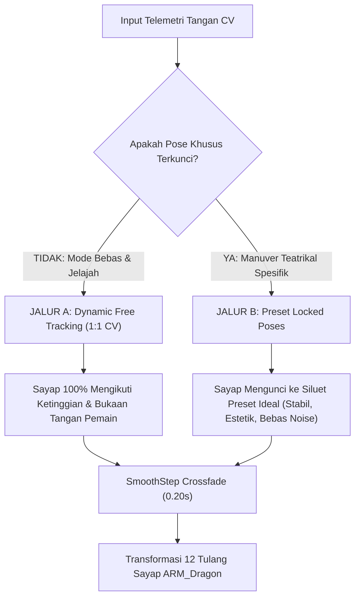

# 🪽 Spesifikasi Final: Dynamic Wings (Dual-Track), Dynamic Head (3-Sumbu), & Animasi Terpadu
## Fanamir: The Sky Guardian *(Internal Project: AR Dragon)*

> **Dokumen Resmi Keputusan Desain & Arsitektur (Laptop A):**
> Dokumen ini membakukan spesifikasi teknis hasil kesepakatan final mengenai:
> 1. **Dynamic Wings Movement (Dual-Track System):** Pemisahan tegas Jalur A (1:1 mengikuti tangan bebas) vs Jalur B (Preset Terkunci) dan logika kemudi *Wing Overdrive Steer*.
> 2. **Dynamic Head Movement (Pelacakan Wajah 3-Sumbu):** Pelacakan Pitch, Yaw, dan Roll wajah pemain dengan distribusi leher bertingkat 3-segmen, kamera melirik sinematik ($10\text{--}12\%$), dan kunci aerodinamis kecepatan tinggi.
> 3. **Sinkronisasi Kode Studio Three.js:** Penanaman siklus trotting 4 kaki di tanah (`computeTrottingLegAngles`) dan kepakan badai Propeller Dash ($3.8\text{ Hz}$) dari `dragon_anim_studio/studio.js` ke Unity C#.

---

## 🪽 1. Arsitektur Dynamic Wings: Dual-Track System

### 1.1. Matriks Pembagian Jalur Sayap
Untuk mencegah inkonsistensi visual dan getaran sensor webcam pada manuver teatrikal, kendali 12 tulang sayap (`Wing_Shoulder.L/R`, `Wing_Forearm.L/R`, `Wing_Finger_Outer..Inner.L/R`) dipisahkan menjadi dua jalur:

| Jalur Kendali | Daftar Pose | Karakteristik Pergerakan Sayap |
| :--- | :--- | :--- |
| **JALUR A: Dynamic Free Tracking (1:1)** | • **`#08` Glide (T-Pose)** • **`#07` Fly Up (Y-Pose)** • **`#06` Flap to Climb** • **`#09A/#09B` Hover (L-Pose)** | **Sayap Mengikuti Tangan 1:1:** - Ketinggian pergelangan tangan kiri & kanan dibaca independen (*asimetris*). - Jarak bentangan tangan memodulasi kembang-kuncup membran 4 jari sayap (*finger fan*). |
| **JALUR B: Preset Locked Poses (Spesifik)** | • **`#13` Tuck to Dive** • **`#14` Propeller Dash** • **`#10` Gentle Descent (Low-A)** • **`#12` Fly Down W** • **`#01` Grounded Idle** • **`#15A..C` Village Actions** | **Sayap Mengunci ke Siluet Preset:** - Mengabaikan goyangan tangan minor agar postur naga tetap stabil, gagah, aerodinamis, dan bebas jitter webcam. |

### 1.2. Rumus Pemetaan Tangan 1:1 (Jalur A)
1. **Elevasi Sayap Asimetris Kiri / Kanan:**
   - Dihitung dari delta pergelangan terhadap bahu masing-masing sisi:
     $$\Delta Y_L = \text{Wrist}_L.y - \text{Shoulder}_L.y, \quad \Delta Y_R = \text{Wrist}_R.y - \text{Shoulder}_R.y$$
   - **Pemetaan Sudut Sayap:**
     - $\Delta Y = -0.30$ (tangan di bawah bahu) $\to$ Sayap miring menukik $-30^\circ$.
     - $\Delta Y = 0.00$ (tangan sejajar bahu) $\to$ Sayap membentang datar lurus $0^\circ$.
     - $\Delta Y = +0.45$ (tangan di atas bahu) $\to$ Sayap terangkat diagonal $+40^\circ$.
2. **Bukaan Membran Jari Sayap (*Finger Fan Span*):**
   - Jarak horizontal pergelangan tangan terhadap garis dada (*Arm Openness*, $0.0 \dots 1.0$):
     - Lengan terentang lebar ($1.0$): Membran 4 pasang jari sayap mekar penuh $100\%$.
     - Lengan merapat ke dada ($< 0.4$): Membran jari melipat menyempit lembut mengikuti lekuk tubuh.
3. **Transisi Antar Jalur (Hitch-Free Blend):**
   - Perpindahan Jalur A $\leftrightarrow$ Jalur B menggunakan `Mathf.SmoothStep` durasi **`0.20s`** untuk mencegah sayap meloncat kaget (*zero snapping*).

### 1.3. Logika Kemudi Belok Sayap (*Wing Overdrive Steer*)
- **Kemudi Utama:** Tetap dipegang penuh oleh kemiringan bahu pemain (*Shoulder Lean*).
- **Asistensi Belok Sayap Miring Ekstrem:**
  - Perbedaan tinggi sayap $|\Delta Y_L - \Delta Y_R|$ di bawah ambang batas ($|\Delta Y| \le 0.15$ atau rotasi $\le 18^\circ$) **hanya menggerakkan visual sayap**, tanpa membelokkan arah terbang naga (pemain bebas berekspresi santai tanpa takut melenceng).
  - Jika sayap dibuat **sangat miring tajam** ($|\Delta Y| > 0.15$ atau $> 18^\circ$), selisih sayap otomatis menyuntikkan kemudi tambahan (*Wing Overdrive Steer*):
    $$\text{Steer}_{\text{wing}} = \text{Sign}(\Delta Y_L - \Delta Y_R) \cdot (|\Delta Y_L - \Delta Y_R| - 0.15) \cdot 1.5$$
    $$\text{TotalYawTurn} = \text{Clamp}(\text{ShoulderSteer} + \text{Steer}_{\text{wing}}, -1.0, +1.0)$$

---

## 🐲 2. Arsitektur Dynamic Head Movement (Pelacakan Wajah 3-Sumbu)

### 2.1. Tiga Sumbu Gerak Wajah
CV mengalirkan orientasi kepala lengkap ke Unity:
1. **Pitch (Mendongak / Menunduk, $\pm 25^\circ$):**
   - Sudut garis hidung ke dagu (`Nose -> Chin`) terhadap bidang vertikal kanonik (`HEAD_PITCH`).
2. **Yaw (Menoleh Kiri / Kanan, $\pm 35^\circ$):**
   - Deviasi posisi horizontal hidung terhadap titik tengah kedua bahu:
     $$\text{HeadYaw} = \frac{\text{Nose}_x - \text{MidShoulder}_x}{\text{ShoulderWidth}} \cdot K_{\text{yaw}}$$
3. **Roll (Kemiringan Miring Kepala, $\pm 15^\circ$):**
   - Sudut kemiringan garis kedua mata/telinga pemain terhadap bidang horizontal.

### 2.2. Distribusi Leher Bertingkat (*Hierarchical Neck Blend*)
Rotasi kepala didistribusikan secara organik ke 3 tulang leher:
- **`Neck_01` (Pangkal Leher):** menyerap **$25\%$** rotasi total.
- **`Neck_02` (Tengah Leher):** menyerap **$35\%$** rotasi total.
- **`Head` (Kepala / Tengkorak):** menyerap **$40\%$** rotasi total.
- Dihaluskan dengan `Mathf.SmoothDamp (0.10s–0.12s)` untuk mengeliminasi jitter mikro webcam.

### 2.3. Respon Kamera & Kunci Aerodinamis
1. **Kamera Melirik Sinematik (*Camera Subtle Peek*):**
   - Kamera utama penerbangan mengikuti arah menoleh kepala sebesar $\sim 10\text{--}12\%$ via `Mathf.SmoothDamp (0.25s)`. Ketika pemain menoleh mengamati pemandangan pulau, sudut kamera melirik halus memberi rasa keterlibatan sinematik.
2. **Kunci Aerodinamis Kecepatan Tinggi (Opsi A):**
   - Pada manuver kecepatan tinggi (**`#13 Tuck to Dive`** dan **`#14 Propeller Dash`** saat kecepatan $\ge 22\text{ m/s}$), nilai Yaw dan Roll kepala diredam lembut ke $0^\circ$ dalam $0.20\text{s}$. Kepala dan moncong naga mengunci lurus ke depan mengikuti vektor angin demi kestabilan aerodinamis.

---

## 🐾 3. Sinkronisasi Kode Animasi Three.js Studio ke Unity C#

### 3.1. Siklus Jalan 4 Kaki di Daratan (`GroundedWalk` Trotting Gait)
Memindahkan fungsi `computeTrottingLegAngles` dari `studio.js` ke `DragonBodyAnimator.cs`:
- Saat status naga di darat (`isGrounded`) dan bergerak maju ($3.5\text{ m/s}$):
  - **Pasangan Diagonal 1:** Kaki Depan Kiri + Kaki Belakang Kanan melangkah maju serempak.
  - **Pasangan Diagonal 2:** Kaki Depan Kanan + Kaki Belakang Kiri melangkah maju serempak.
  - Frekuensi langkah $\approx 1.4\text{ Hz}$ disinkronkan dengan hentakan cakar bergantian `SFX_Dragon_Footstep_01/02`.

### 3.2. Kepakan Sayap Bertenaga Badai Propeller Dash ($3.8\text{ Hz}$)
Memindahkan fungsi `evaluatePropellerDashStroke` dari `studio.js` ke `DragonWingAnimator.cs`:
- Mengganti orbit heliks lama dengan kepakan asimetris $3.8\text{ Hz}$:
  - Upstroke $35\%$ durasi siklus (melengkung aerodinamis ke belakang).
  - Power Downstroke $65\%$ durasi siklus (menghantam ke bawah dengan kurva akselerasi kubik).
  - *Tip Lag:* Jari luar sayap (`Wing_Finger_Outer`) melengkung tertinggal menahan tekanan udara, menyatu dengan audio *SFX_PropellerDash_Loop (Whoosh Berat)*.

---

*Navigasi:*
[[00 - Overview]] | [[Tasks]] | [[Devlog]] | [[visual-vfx/planning_perbaikan_animasi_dan_pose]] | [[handoff-laptop-b/prompt_eksekusi_animasi_final_laptop_b]]
