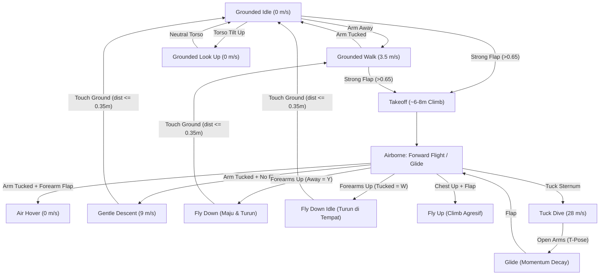

# 📋 PRODUCT REQUIREMENTS DOCUMENT (PRD) & DEVELOPMENT PLAYBOOK: AR DRAGON SKY GUARDIAN (v6.0)

> **Catatan Penamaan:** Project Unity = `AR Dragon Sky Guardian`, folder Python = `ARDragonSkyGuardian_CV`. Namespace C# = `DragonWingAR.*`.
> **Mode Kerja:** Kolaborasi Manusia (User/Developer) + AI Agent (Hermes / Antigravity Agent).
> **Rujukan Utama:** Dokumen teknis dan rumus matematika merujuk pada [`konteks.md`](file:///d:/Fauzih/Kuliah/SEMESTER%20V/Proyek%20Multimedia%20dan%20Game/AR%20Dragon/konteks.md).

---

## 🎯 1. VISI & TUJUAN PRODUK

AR Dragon Sky Guardian adalah game *PC exergaming* 3D berbasis input Computer Vision (kamera webcam) yang memadukan kebebasan simulasi penerbangan naga alami ala **Sky Peck** di atas pulau semi-terbuka (*semi-open-world*) dengan gameplay edukatif penyelamatan lingkungan.

### Sasaran Utama:
1. **Zero-Equipment Barrier:** Pemain hanya membutuhkan laptop/PC berkamera standar tanpa memerlukan sensor mahal (seperti Kinect atau VR headset).
2. **Kontrol Tubuh Alami Berbasis Mekanik Sky Peck:**
   - **Flap to Climb (Mengepakkan Tangan):** Menghasilkan daya angkat vertikal halus ($+6.5\text{ m/s}$) + dorongan maju ($+12\text{ m/s}^2$). **Decoupled:** Bebas dari goyangan pitch nodding bolak-balik saat tangan diayun naik-turun.
   - **Glide (Rentangkan Sayap):** Meluncur jelajah santai dengan sink rate alami yang anggun ($-1.0\text{ m/s}$) pada kecepatan $14\text{ m/s}$.
   - **Tuck to Dive (Pose Foto Pengguna):** Tangan mengepal di dada atas, siku mengarah ke bawah di samping badan, memicu terjun menukik tajam (pitch $-40^\circ \sim -45^\circ$) dengan akselerasi tinggi hingga $28\text{ m/s}$.
   - **Propeller Dash (Dorongan Cepat):** Rotasi lengan melingkar terus-menerus memicu dorongan kecepatan akseleratif hingga $26\text{ m/s}$.
   - **Swoop Climb Out of Dive:** Membuka sayap setelah dive secara otomatis mengonversi kelebihan kecepatan kinetik menjadi luncuran melambung menanjak (*swoop soaring climb*) yang megah ke angkasa.
   - **Continuous Lean to Bank & Turn:** Kemiringan kombinasi torso ($50\%$) dan lengan ($50\%$) membelokkan arah yaw ($65^\circ/\text{s}$) dan memiringkan sayap naga secara visual ($\pm 35^\circ$).
3. **Zero-Manual Python Launch:**
   - Unity mengelola proses Python secara otomatis (`PythonProcessManager.cs`). Pemain cukup menekan tombol Play di Unity dan Python CV langsung aktif serta tertaut otomatis tanpa membuka terminal terpisah.
4. **Arsitektur Input Modular (`IFlightInputProvider`):**
   - Karakter controller terisolasi dari detail sensor mentah kamera melalui antarmuka modular `IFlightInputProvider` dan `DefaultFlightInputMapper`.
5. **Performa Tinggi & Bebas Lag:**
   - Inferensi AI YOLOv8n-pose $\le 18\text{ ms}$ di GPU CUDA (54+ FPS).
   - Komunikasi UDP lokal tanpa jeda input (*instant response*).
   - Tampilan visual pulau dan naga stabil pada 60 FPS di Unity 6 URP.

---

## 🗺️ 2. STATUS ROADMAP PENGEMBANGAN

| Tahap / Sesi | Fokus Utama | Status | Hasil Utama |
| :--- | :--- | :---: | :--- |
| **Tahap 0** | Setup Environment Unity & Python | ✅ **SELESAI** | Unity 6 URP, venv Python, PyTorch CUDA, OpenCV. |
| **Sesi 1** | Evaluasi & Penguncian Model CV | ✅ **SELESAI** | Model YOLOv8n-pose terpilih, stabilisasi One-Euro filter, head-crop mouth tracker. |
| **Sesi 2** | Integrasi Socket UDP & Navigasi Terbang | ✅ **SELESAI** | UDP 5052 (Pose) & 5053 (PIP Video), Ground raycast protection, Keyboard fallback zero-conflict. |
| **Sesi 3** | Integrasi Aset 3D & In-Game HUD | ✅ **SELESAI** | `Dragon_Model.blend` (Skala 5m, URP Lit double-sided), `pulau.blend` (800x800m), InGameFlightHUD lengkap. |
| **Sesi 4** | Mekanik Sky Peck, Input Mapper & Auto-Launch | ✅ **SELESAI** | Flap Climb (decoupled), Lean Turn, Tuck Dive (28 m/s), Propeller Dash (26 m/s), Swoop Climb, `IFlightInputProvider`, `PythonProcessManager.cs`. |
| **Sesi 5** | Zona 3 Desa, Mekanik Misi, & VFX | ⏳ **SELANJUTNYA** | `VillageZoneController` di 3 Pad desa, sistem timer, partikel polusi/kebakaran/kekeringan, dan audio ambience. |
| **Sesi 6** | UI Lobby, Sistem Bintang, & Build PC | ⏳ **TERAKHIR** | Menu pemilihan level, skor bintang 1-3, sound effects, dan ekspor executable `.exe` Windows. |

---

## 🛠️ 3. SPESIFIKASI SESI IMPLEMENTASI

---

### 🔬 SESI 1: KOMPUTASI VISION & BIOMETRIK TERKUNCI (SELESAI ✅)
- **Modul Python:** `ARDragonSkyGuardian_CV/active_cv_sender.py`
  - YOLOv8n-pose dengan primary target locking (bounding box terbesar).
  - `RobustKeypointTracker`: Dynamic arm length clamping, Adaptive One-Euro filter, dan kinematic velocity gating untuk mencegah jitter tangan.
  - `BiometricNormalizer`: Normalisasi skala, jarak, dan posisi pemain di depan kamera.
  - `MouthTracker`: Head-cropped mouth openness detection untuk mendeteksi semburan air purba.
  - Dual UDP streaming: port `5052` (telemetri pose 39-float) dan port `5053` (JPEG frame preview PIP Unity).

---

### 🕹️ SESI 2: PONDASI SOCKET UDP & KONTROL TERBANG DASAR (SELESAI ✅)
- **Komponen Unity:**
  - `UDPPoseReceiver.cs`: Mendengarkan UDP `5052`, mem-parsing data CSV 39-float, serta menyediakan fallback keyboard zero-conflict yang tidak menimpa data kamera.
  - `DragonFlightController.cs`: Navigasi terbang dasar, kemudi Yaw/Pitch, dan deteksi ground raycast protection.

---

### 🐉 SESI 3: INTEGRASI ASET 3D PULAU, NAGA, & HUD (SELESAI ✅)
- **Aset 3D:**
  - **Pulau (`pulau.blend` / `pulau.fbx`):** Ukuran $813\text{ m} \times 800\text{ m}$ dengan terrain, bebatuan bukit, dan 3 danau organik.
  - **Naga (`Dragon_Model.blend` / `Dragon_Model.fbx`):** Dimensi bentang sayap $5.06\text{ m}$, panjang $3.60\text{ m}$, tinggi $1.59\text{ m}$. Shading menggunakan 12 material URP Lit double-sided rendering.
  - **Kamera Follow:** Posisi `(0, 2.5, -6.5)`, sudut $14^\circ$, memberikan sudut pandang sinematik yang proporsional.
- **In-Game Flight HUD (`InGameFlightHUD.cs`):**
  - **Kiri Atas:** Telemetri penerbangan naga (Airspeed, Sudut Pitch, Ketinggian, Status Mode Sky Peck, Slider Kemudi Lean, Indikator Aksi Gestur, Python CV Status PID).
  - **Kanan Atas:** Kotak Picture-in-Picture (PIP) menampilkan stream kamera langsung dari port 5053, dengan fallback radar kerangka tubuh interaktif lengkap dengan sendi siku.
  - **Bawah Layar:** Panduan kontrol singkat yang jelas.

---

### 🦅 SESI 4: MEKANIK PENERBANGAN ALA SKY PECK, INPUT MAPPER & AUTO-LAUNCH PYTHON (SELESAI ✅)
- **Fisika Penerbangan Sky Peck (`DragonFlightController.cs`):**
  - **Flap to Climb (Mendaki Vertikal Halus):** Mengepakkan tangan memberikan dorongan vertikal $+6.5\text{ m/s}$ dan dorongan akselerasi $+12\text{ m/s}^2$. Pitch tetap stabil ($+8^\circ \sim +12^\circ$), bebas dari nodding/goyangan bolak-balik saat tangan diayun.
  - **Lean to Turn & Bank:** Menggabungkan $50\%$ kemiringan lengan (*arm tilt*) dengan $50\%$ pergeseran sumbu torso (*torso lean*), memungkinkan pemain berbelok lincah dengan memiringkan tangan ataupun mencondongkan badan.
  - **Tuck to Dive (Pose Foto Pengguna):** Tangan dirapatkan mengepal di dada atas dengan siku mengarah ke bawah di samping badan. Sayap melipat aerodinamis rapat, hidung menukik tajam ($-40^\circ \sim -45^\circ$), dan naga meluncur kencang hingga batas $28\text{ m/s}$.
  - **Propeller Dash:** Memutar lengan secara melingkar kontinu menghasilkan dorongan akselerasi impulsif instan hingga $26\text{ m/s}$.
  - **Swoop Climb Out of Dive:** Membuka sayap setelah dive secara otomatis mengonversi kelebihan kecepatan ($> 14\text{ m/s}$) menjadi luncuran melambung naik (*swoop soaring climb*) yang megah, mengangkat ketinggian naga ke awan tanpa perlu mengepakkan tangan.
  - **Glide & Gentle Descent:** Meluncur jelajah santai dengan sink rate alami yang sangat lembut ($-1.0\text{ m/s}$) pada kecepatan $14\text{ m/s}$.
  - **Terrain Safety Protection:** Raycast otomatis ke bawah sejauh $500\text{ m}$ menjaga naga minimal $3.5\text{ m}$ di atas permukaan daratan dan meratakan hidung naga secara otomatis jika jarak $< 8.0\text{ m}$.
- **Arsitektur Input Modular (`IFlightInputProvider.cs` & `DefaultFlightInputMapper.cs`):**
  - Pemisahan data sensor CV dari controller gerak naga.
  - Penyesuaian kurva sensitivitas non-linear ($1.35$) dan anti-fatigue flap multiplier ($1.15$).
- **Peluncur Proses Otomatis (`PythonProcessManager.cs`):**
  - Mengelola lifecycle proses `active_cv_sender.py` secara otomatis.
  - Meluncurkan Python di background saat Play Mode dimulai (`Awake`/`OnEnable`).
  - Menghentikan proses Python beserta child process tree-nya seketika saat Play Mode berhenti (`ExitingPlayMode`/`OnApplicationQuit`), menjamin webcam tidak pernah terkunci (*zero webcam lock*).
  - Terpasang rapi pada GameObject `Dragon_Player` di scene `Test_Dragon_Flight.unity`.

---

### 🏡 SESI 5: INTERAKSI ZONA 3 DESA, MEKANIK TANTANGAN, & VFX (LANGKAH SELANJUTNYA ⏳)

**Tujuan Sesi:** Memasang *gameplay loop* pemulihan 3 desa di lokasi pad pulau yang sudah tersedia.
- **Desa 1 (Polusi Udara):** Pad `Pad_Desa1_Polusi` (-200, 0.13, 80). Gestur kepakan sayap untuk mengibas kabut asap.
- **Desa 2 (Kebakaran Hutan):** Pad `Pad_Desa2_HutanKebakaran` (10, 0.23, -133). Gestur buka mulut lebar / tangkup tangan untuk semburan air purba.
- **Desa 3 (Kekeringan Tanah):** Pad `Pad_Desa3_Kekeringan` (260, 0.82, 13). Gestur angkat kedua tangan tinggi ke langit untuk panggil hujan embun.
- **Implementasi Komponen C#:**
  - `VillageZoneController.cs` pada setiap pad desa dengan radius deteksi trigger 25-35m.
  - Auto-Hover lock dan progress meter 0-100% (5 detik eksekusi gestur).
  - Sistem partikel VFX (Asap partikel, Api partikel, dan Efek Hujan Partikel Embun).

---

### 🏆 SESI 6: POLISH UI, SCORING BINTANG & EXPORT PC BUILD (TERAKHIR ⏳)
- Menu Utama (Lobby, Pengaturan Kamera & Sensitivitas).
- Sistem penilaian 1-3 bintang berdasarkan kecepatan pemulihan 3 desa.
- Sound effects penerbangan (wind rush, flap whoosh, water splash) dan background ambience.
- Build release standalone `.exe` Windows 64-bit.

---

## 🧭 4. ON-GROUND MECHANICS & ARM-PROXIMITY LOCOMOTION (UPGRADE v6.1)

### 4.1 Latar Belakang Masalah & Sasaran Pembaruan
* **Masalah Saat Ini:** Saat game/scene dijalankan (Play Mode), naga langsung spawn di udara melayang (ketinggian $Y=22$) dengan kecepatan luncur maju otomatis $14\text{ m/s}$ sebelum modul kamera CV siap atau sebelum pemain membentuk pose tubuh. Hal ini tidak realistis, merusak imersi awal pemain (*jarring start*), dan rentan memicu disorientasi.
* **Tujuan Utama:**
  1. Naga melakukan spawn awal di permukaan tanah (**Grounded Spawn**) dalam kondisi diam sempurna ($0\text{ m/s}$).
  2. Naga hanya bergerak apabila pemain secara sadar membentuk pose input yang valid.
  3. Menggunakan satu kerangka logika lokomosi terpadu yang konsisten antara daratan (*Ground*) dan udara (*Air*), berbasis metrik **jarak lengan atas ke torso (*Upper Arm Proximity / Openness*)**.
  4. Proteksi *tracking loss*: jika deteksi kamera terputus di daratan, naga tetap diam di tempat (*safe resting state*).

---

### 4.2 Matriks 12 State Terpadu (Ground & Airborne State Architecture)

| No | Nama State | Lingkungan | Kondisi Gestur Fisik Pemain | Perilaku Naga & Kecepatan |
| :---: | :--- | :---: | :--- | :--- |
| **1** | **Grounded Idle** | Ground | Lengan atas rapat ke badan (*tucked*), tanpa kepakan. | Naga berdiri diam di tanah. Kecepatan maju $= 0\text{ m/s}$, rotasi diam. |
| **2** | **Grounded Walk** | Ground | Lengan atas menjauh/terangkat (*away*, T-pose darat). | Naga berjalan maju santai di daratan. Kecepatan maju $= \text{walkSpeed}$ ($3.5\text{ m/s}$). |
| **3** | **Grounded Look Up** | Ground | Dada terangkat / torso tilt ke atas sedikit, di darat. | Naga mendongak (pitch up $+12^\circ \sim +18^\circ$) mengamati langit tanpa bergerak maju ($0\text{ m/s}$) dan TIDAK terbang. |
| **4** | **Takeoff** | Transisi (G $\to$ A) | Di darat, kepakan kuat kedua tangan ($>0.65$ power, $\ge 0.25\text{ s}$). | Naga mengepakkan sayap kuat, melompat lepas landas vertikal $+6 \sim 8\text{ meter}$ ke udara memasuki fase airborne. |
| **5** | **Air Idle / Gentle Descent** | Air | Lengan atas rapat (*tucked*), lengan bawah santai terentang, tanpa kepakan. | Naga meluncur maju lembut sambil turun perlahan menuju tanah ($8 \sim 10\text{ m/s}$, sink rate $-1.5\text{ m/s}$) hingga mendarat. |
| **6** | **Hover** | Air | Lengan atas rapat (*tucked*) + kepakan ritmis lengan bawah (*forearm flap*). | Melayang stasioner di udara. Kecepatan maju $= 0\text{ m/s}$, vertikal stabil dengan osilasi *hover bobbing*. |
| **7** | **Forward Flight** | Air | Kepakan kedua tangan penuh secara ritmis (lengan atas *away*). | Terbang maju aktif dengan daya dorong akseleratif ($12 \sim 21\text{ m/s}$) dan gaya angkat vertikal. |
| **8** | **Glide** | Air | Lengan atas menjauh (*away*) + kedua tangan lurus mendatar (T-pose udara). | Meluncur anggun tanpa kepakan. Kecepatan mengikuti momentum (meluruh halus ke cruise speed $14\text{ m/s}$), sink rate $-1.0\text{ m/s}$. |
| **9** | **Fly Up** | Air | Torso / dada tilt ke atas sedikit + kepakan kedua tangan aktif. | Menanjak tajam ke angkasa (pitch $+20^\circ \sim +24^\circ$, vertical climb $+11\text{ m/s}$, forward speed hingga $21\text{ m/s}$). |
| **10** | **Fly Down (Pose Y)** | Air | Lengan atas menjauh (*away*) + lengan bawah mengarah ke atas (Pose "Y"). | Hidung menunduk turun sambil tetap meluncur maju secara terarah (sink rate $-4.5\text{ m/s}$, forward speed $12\text{ m/s}$). |
| **11** | **Fly Down Idle (Pose W)** | Air | Lengan atas rapat (*tucked*) + kedua lengan bawah mengarah ke atas (Pose "W"). | Turun perlahan di tempat (*vertical descent* $0\text{ m/s}$ maju, sink rate $-2.5\text{ m/s}$). Terpisah dari Gentle Descent! |
| **12** | **Dive (Tuck Dive)** | Air | Tangan mengepal rapat di dada/sternum, siku mengarah ke bawah di samping torso. | Terjun menukik tajam (pitch $-40^\circ \sim -45^\circ$), akselerasi gravitasi tinggi hingga $28\text{ m/s}$, menghimpun momentum kinetik besar. |

> [!NOTE]
> **Asumsi Desain:** **Glide** (T-pose penuh, lengan atas *away*) dan **Gentle Descent** (lengan atas *tucked*, tanpa kepak) adalah dua state terpisah. Gentle Descent memiliki kecepatan maju lebih lambat ($8\sim 10\text{ m/s}$) dan laju penurunan lebih teratur menuju daratan, sedangkan Glide mempertahankan momentum jelajah tinggi ($14\text{ m/s}$) dengan aerodinamika luncur halus.

---

### 4.3 Matriks Pemetaan Input $\to$ Perilaku (Ground vs Air)

| Pola Input Gestur Tubuh | Perilaku di Permukaan Tanah (Ground) | Perilaku di Udara (Airborne) | Respon Kecepatan |
| :--- | :--- | :--- | :--- |
| **Upper Arm Tucked (Rapat Badan)** | Berhenti total (**IDLE**) | Masuk **Gentle Descent** (turun santai) atau **Hover** (jika ada kepak lengan bawah) | Ground: $0\text{ m/s}$ Air: $0\text{ m/s}$ (Hover) / $9\text{ m/s}$ (Gentle) |
| **Upper Arm Away (Terangkat / T-Pose)** | Berjalan maju (**WALK**) | Meluncur anggun (**GLIDE**) mempertahankan momentum | Ground: $3.5\text{ m/s}$ Air: Momentum $\to 14\text{ m/s}$ |
| **Body Lean (Kiri / Kanan)** | **Rotasi di tempat** (jika Idle) atau **Belok sambil jalan** (jika Walk) | **Continuous Bank & Turn** (Yaw $72^\circ/\text{s}$, Roll sayap $\pm 38^\circ$) | Rotasi Ground: $65^\circ/\text{s}$ Rotasi Air: $72^\circ/\text{s}$ |
| **Torso Tilt Up (Dada Terangkat)** | **Melihat ke atas (Look Up)**, naga mendongak tanpa terbang | **Fly Up** (jika disertai kepakan) menanjak ke langit | Ground: $0\text{ m/s}$ Air: Hingga $21\text{ m/s}$ |
| **Kepakan Sayap Penuh (Flapping)** | Memicu **Takeoff** (jika kekuatan $\ge 0.65$) | Menghasilkan gaya angkat lift & thrust (**Forward Flight**) | Ground: Vertikal $+6\text{ m/s}$ Air: $+6.5\text{ m/s}$ lift |
| **Pose Y (Forearm Up, Arm Away)** | Pose netral / walk lambat | **Fly Down Maju** (menunduk sambil maju) | Air: Maju $12\text{ m/s}$, Sink $-4.5\text{ m/s}$ |
| **Pose W (Forearm Up, Arm Tucked)** | Pose netral / idle | **Fly Down Idle** (turun perlahan di tempat) | Air: Maju $0\text{ m/s}$, Sink $-2.5\text{ m/s}$ |
| **Tuck Dive (Tangan Rapat di Sternum)** | Pose netral / idle | **Dive Kecepatan Tinggi** menukik tajam | Air: Akselerasi hingga $28\text{ m/s}$ |

---

### 4.4 Aturan Prioritas & Transisi State

1. **Transisi Ground $\to$ Air (Takeoff):**
   * Kondisi awal: Naga berstatus `isGrounded = true`.
   * Syarat trigger: Kepakan kedua tangan terdeteksi kuat dengan `flapPower >= takeoffFlapThreshold` ($0.65$) dan bertahan minimal $0.25\text{ detik}$.
   * Aksi: Naga melesat naik vertikal $+6 \sim 8\text{ meter}$ di atas permukaan tanah. Setelah mencapai ambang ketinggian takeoff, naga beralih status ke `isGrounded = false` (Airborne).
   * Kenaikan lebih tinggi hanya dapat dicapai melalui kombinasi gestur **Fly Up** (dada terangkat + kepakan tangan ritmis).
2. **Transisi Air $\to$ Ground (Landing):**
   * Kondisi awal: Naga berstatus `isGrounded = false` (Airborne).
   * Syarat trigger: Jarak raycast vertikal ke permukaan daratan $\le 0.35\text{ meter}$ dengan laju turun vertikal $\le 0.5\text{ m/s}$.
   * Aksi: Transisi mulus ke `isGrounded = true`. Kecepatan maju diredam secara lembut menggunakan friksi darat (*ground deceleration lerp*) menuju $0\text{ m/s}$ jika lengan *tucked*, atau menuju `walkSpeed` ($3.5\text{ m/s}$) jika lengan *away*. Zero clipping, zero physics hitch.
3. **Tracking Loss Safety:**
   * Ground: Jika tracking kamera terputus / belum stabil, naga terkunci dalam `Grounded Idle` ($0\text{ m/s}$, rotasi diam).
   * Air: Jika tracking terputus di udara, naga beralih aman ke `Gentle Descent` meluncur turun perlahan hingga menyentuh tanah dan beristirahat aman di darat.

---

### 4.5 Daftar Parameter Terkonfigurasi (Configurable Parameters)

* **Parameter Fisika Darat (Ground Movement & Takeoff):**
  * `walkSpeed`: $3.5\text{ m/s}$ (kecepatan jalan naga di tanah).
  * `groundTurnSpeed`: $65^\circ/\text{s}$ (kecepatan rotasi di darat).
  * `groundFrictionRate`: $6.0\text{ s}^{-1}$ (pelicinan deselerasi berhenti di tanah).
  * `groundAccelRate`: $5.0\text{ s}^{-1}$ (pelicinan akselerasi jalan di tanah).
  * `groundLookUpMaxPitch`: $25^\circ$ (sudut pitch maksimum saat Look Up di darat).
  * `takeoffTargetHeight`: $4.5\text{ m}$ (ketinggian target di atas permukaan tanah saat Takeoff dari darat).
  * `takeoffFlapThreshold`: $0.35$ (ambang batas kekuatan kepakan minimum untuk takeoff).
  * `takeoffMinDuration`: $0.25\text{ s}$ (durasi minimal kepakan konsisten sebelum takeoff).
  * `takeoffInitialClimbVel`: $6.5\text{ m/s}$ & `takeoffInitialForwardSpeed`: $7.0\text{ m/s}$ (kecepatan awal lepas landas).
  * `groundContactHeight`: $0.85\text{ m}$ & `landingThresholdOffset`: $0.20\text{ m}$ (tinggi kontak & toleransi transisi mendarat mulus Air -> Grounded).
* **Parameter Fisika Udara & Momentum:**
  * `cruiseSpeed`: $14.0\text{ m/s}$ (kecepatan jelajah aerodinamis glide).
  * `glideMomentumDecayRate`: $0.85\text{ s}^{-1}$ (laju peluruhan momentum kelebihan kecepatan paska-dive menuju cruise speed).
  * `flapHoldLift`: $1.2\text{ m/s}$ (daya angkat terbatas saat kepakan di udara tanpa tilt dada ke atas).
  * `flyDownYSinkRate`: $5.5\text{ m/s}$ & `flyDownYSpeed`: $12.0\text{ m/s}$ (laju turun & kecepatan maju saat Pose Y).
  * `flyDownWSinkRate`: $3.2\text{ m/s}$ & `flyDownWDecelRate`: $4.5\text{ s}^{-1}$ (laju turun pelan & deselerasi di tempat saat Pose W).
  * `gentleDescentSpeed`: $8.5\text{ m/s}$ (kecepatan maju saat Gentle Descent).
  * `gentleDescentSinkRate`: $1.6\text{ m/s}$ (laju turun santai menuju tanah).
  * `flyUpLiftPower`: $10.0\text{ m/s}$ (daya angkat saat dada mendongak + kepak).
* **Parameter Ambang Gestur (Biometrics & Proximity Thresholds):**
  * `upperArmTuckedThreshold`: $0.38$ (ambang siku mendekati badan normalisasi lebar bahu).
  * `upperArmAwayThreshold`: $0.55$ (ambang lengan terangkat / menjauh dari badan).
  * `proximityHysteresisDuration`: $0.15\text{ s}$ (jeda konfirmasi anti-flicker transisi tucked/away).
  * `forearmUpAngleThreshold`: $65^\circ$ (sudut kemiringan lengan bawah ke atas untuk Pose Y & W).
  * `chestElevationThreshold`: $1.72$ (rasio elevasi dada untuk deteksi Fly Up).

---

## 🔒 5. DEFERRED — DRAGON ANIMATION & POSE PLAN (DOKUMENTASI PERENCANAAN)

> [!IMPORTANT]
> **Status Fitur:** **DITANGGUHKAN (*DEFERRED*)** — Bagian ini hanya berfungsi sebagai cetak biru arsitektur dokumentasi dan **TIDAK DIIMPLEMENTASIKAN** pada fase saat ini. Tidak ada modifikasi pada rigging, blendshapes, skeleton bone, atau animation controller naga. Pengerjaan akan menunggu keputusan pengguna paska validasi Fase A-D selesai.

### 5.1 Rencana Pemetaan Sayap Dinamis (*Dynamic Wing Pose Mapping*)
* **Wing Flapping Mengikuti Pose Pemain:** Menghubungkan rotasi sendi pergelangan (*wrist*) dan siku (*elbow*) pemain dari modul CV langsung ke rig tulang sayap naga (*bone mapping*) menggunakan inverse/forward kinematics lembut.
* **Special Pose Override (Dive Pose):** Saat state mesin mendeteksi `Tuck to Dive`, sayap naga beralih kaku mengunci ke pose aerodinamis melipat sayap rapat di sepanjang punggung naga (*rigid dive tuck*), menimpa mapping tangan mentah untuk estetika visual yang gagah.
* **Layering & Blending:**
  * Base Layer: Animasi locomotion dasar (Ground Idle breathing, Walking cycle, Gliding idle loop).
  * Additive / Procedural Layer: Pose sayap adaptif real-time dan kemiringan leher/ekor saat berbelok (*banking bend*).
* **Kesiapan Arsitektur:** Arsitektur input `IFlightInputProvider` dan `DragonFlightController` dirancang sepenuhnya *decoupled*. Penambahan komponen animasi di masa mendatang cukup membaca properti status `ActiveCommand` dan `CurrentState` tanpa perlu merombak logika CV maupun fisika penerbangan.
